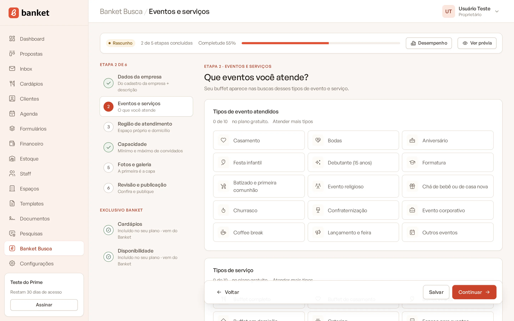
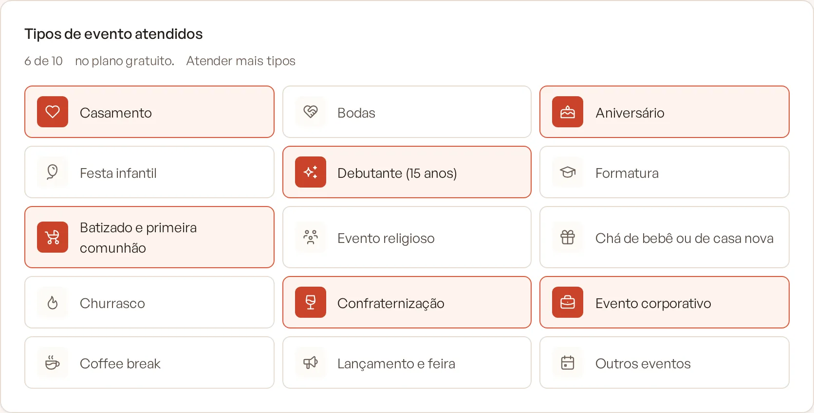
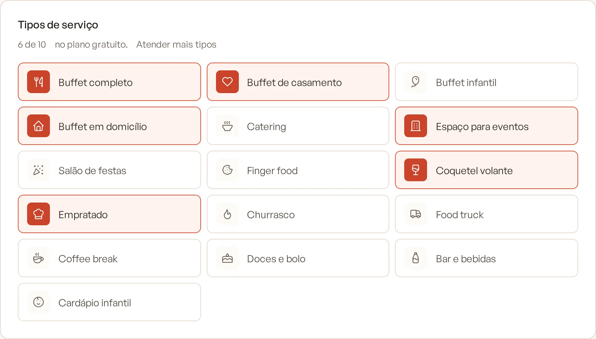
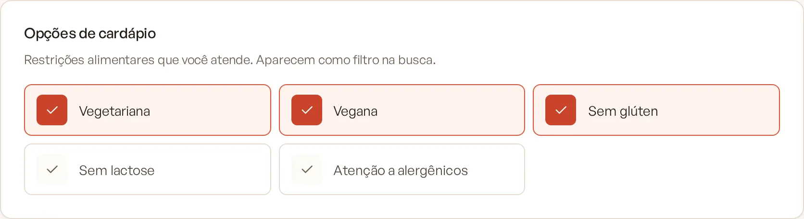

# Etapa 2: eventos e serviços

Nesta etapa você marca o que o seu buffet atende. O perfil só aparece em buscas desses tipos de evento, e os serviços e
opções de cardápio viram filtros que o cliente pode usar.

> **Disponível em:** todos os planos, com limite de tipos por plano · **Quem pode usar:** Proprietário e Administrador

## Passo a passo

1. No menu lateral, clique em **Banket Busca** e abra a etapa **Eventos e serviços**.

   

2. Em **Tipos de evento atendidos**, marque os eventos que você faz (por exemplo, Casamento, Aniversário, Evento
   corporativo, Coffee break).

   

3. Em **Tipos de serviço**, marque como você atende (por exemplo, Buffet completo, Buffet em domicílio, Coquetel volante,
   Empratado, Food truck).

   

4. Em **Opções de cardápio**, marque as restrições alimentares que você atende: Vegetariana, Vegana, Sem glúten, Sem
   lactose e Atenção a alergênicos.

   

5. Clique em **Salvar** ou em **Continuar**.

Para concluir a etapa, marque pelo menos um tipo de evento e um tipo de serviço.

## Limites do plano

| Plano | Tipos de evento | Tipos de serviço |
|---|---|---|
| Busca | 3 | 3 |
| Essencial e Profissional | 6 | 6 |
| Prime | 10 | 10 |
| Master | sem limite | sem limite |

Quando há limite, o cartão mostra quantos você já marcou (por exemplo, "3 de 3"). Ao chegar ao máximo, as demais opções
ficam indisponíveis. O link **Atender mais tipos** abre a oferta de upgrade. As opções de cardápio não têm limite.

## Dicas

- Marque só o que você realmente atende. Pedidos de tipos que você não marcou não chegam até você, e marcar tipos que não
  faz gera contatos que não viram contrato.
- Se o plano tiver limite, priorize os eventos que trazem mais negócio para o buffet.

## Perguntas frequentes

### Mudei de plano e alguns tipos sumiram. O que aconteceu?
Ao voltar para um plano com limite menor, os tipos acima do limite ficam guardados, mas deixam de aparecer no perfil.
Quando você passa de novo para um plano com limite maior, eles voltam.

### Posso marcar mais de um tipo de serviço para o mesmo evento?
Sim. Tipos de evento e tipos de serviço são independentes. Marque todos os que se aplicam, dentro do limite do plano.

### As opções de cardápio mostram os meus pratos?
Não. Elas só indicam que você atende aquela restrição e aparecem como etiquetas no perfil. Os pratos aparecem na seção
Cardápios, nos planos pagos. Veja [Cardápios no perfil](10-cardapios-no-perfil.md).

## Artigos relacionados
- [Etapa 1: dados da empresa](03-etapa-1-dados-da-empresa.md)
- [Etapa 3: região de atendimento](05-etapa-3-regiao-de-atendimento.md)
- [Perfil Simples e Perfil Personalizado](02-perfil-simples-e-personalizado.md)
