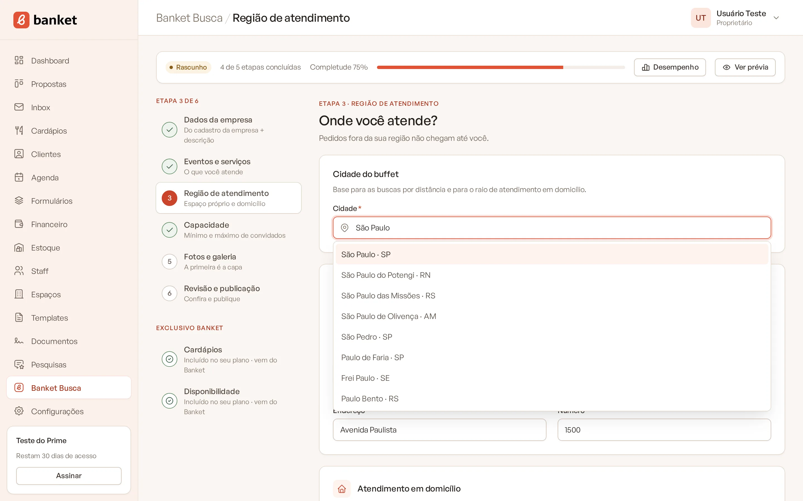
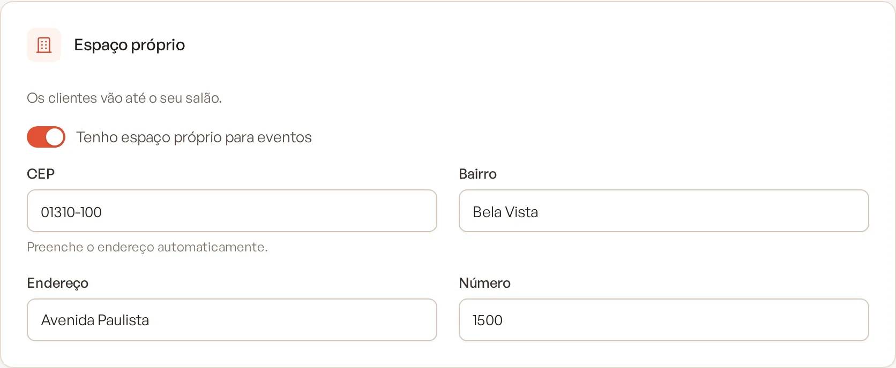
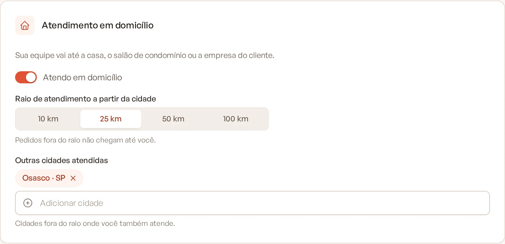
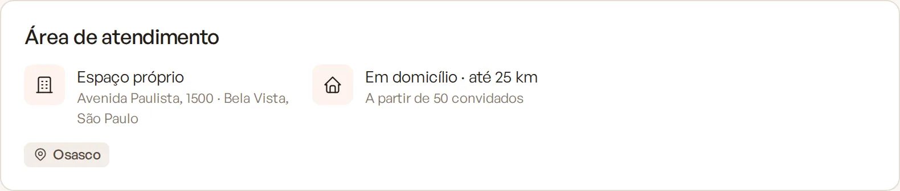

# Etapa 3: região de atendimento

Nesta etapa você diz onde atende. A cidade do buffet é a base das buscas por distância, e o modo de atendimento (espaço
próprio, domicílio ou os dois) define em quais buscas o perfil aparece. Pedidos fora da sua região não chegam até você.

> **Disponível em:** todos os planos · **Quem pode usar:** Proprietário e Administrador

## Passo a passo

1. No menu lateral, clique em **Banket Busca** e abra a etapa **Região de atendimento**.
2. Em **Cidade do buffet**, digite o nome da cidade e escolha uma opção da lista.

   

3. Se os clientes vão até o seu salão, ligue **Tenho espaço próprio para eventos** e preencha:
   - **CEP**: ao sair do campo, o sistema busca o endereço e preenche **Endereço**, **Bairro** e a cidade. Confira o
     **Número**.
   - Se o CEP não for encontrado, aparece "CEP não encontrado. Preencha o endereço à mão."

   

4. Se a sua equipe vai até a casa, o salão de condomínio ou a empresa do cliente, ligue **Atendo em domicílio** e:
   - escolha o **Raio de atendimento a partir da cidade**: 10, 25, 50 ou 100 km;
   - em **Outras cidades atendidas**, adicione cidades fora do raio onde você também atende.

   

5. Clique em **Salvar** ou em **Continuar**.

Para concluir a etapa, escolha a cidade e pelo menos um modo de atendimento: espaço próprio com endereço ou domicílio com
raio.

## Como a região é usada na busca

O perfil aparece para quem busca:

- na mesma cidade do buffet;
- numa das **Outras cidades atendidas**;
- dentro do raio de atendimento em domicílio;
- a uma distância razoável do seu espaço próprio, que o cliente pode percorrer até o evento.

A distância também conta na ordem dos resultados: buffets mais perto de quem busca tendem a aparecer antes.

## Mensagens que podem aparecer

| Mensagem | O que fazer |
|---|---|
| Escolha a cidade na lista. | Digite a cidade e clique numa opção da lista. Texto livre não é aceito. |
| Marque espaço próprio, atendimento em domicílio ou os dois. | Ligue pelo menos uma das opções. |
| Informe o endereço do espaço. | Com espaço próprio ligado, preencha o endereço. |
| Escolha o raio de atendimento. | Com domicílio ligado, escolha 10, 25, 50 ou 100 km. |

## Perguntas frequentes

### O endereço do meu espaço aparece no perfil?
Sim. Com espaço próprio, o perfil mostra o endereço, o número, o bairro e a cidade na seção **Área de atendimento**.

### Atendo em domicílio e tenho espaço. Preciso escolher um?
Não. Ligue as duas opções. O perfil mostra "Espaço próprio e em domicílio".

### Um cliente de uma cidade vizinha não me encontra. Por quê?
Provavelmente a cidade dele está fora do seu raio. Aumente o raio ou adicione a cidade em **Outras cidades atendidas**.

## Artigos relacionados
- [Etapa 2: eventos e serviços](04-etapa-2-eventos-e-servicos.md)
- [Etapa 4: capacidade](06-etapa-4-capacidade.md)
- [Como os resultados são ordenados](13-como-os-resultados-sao-ordenados.md)
