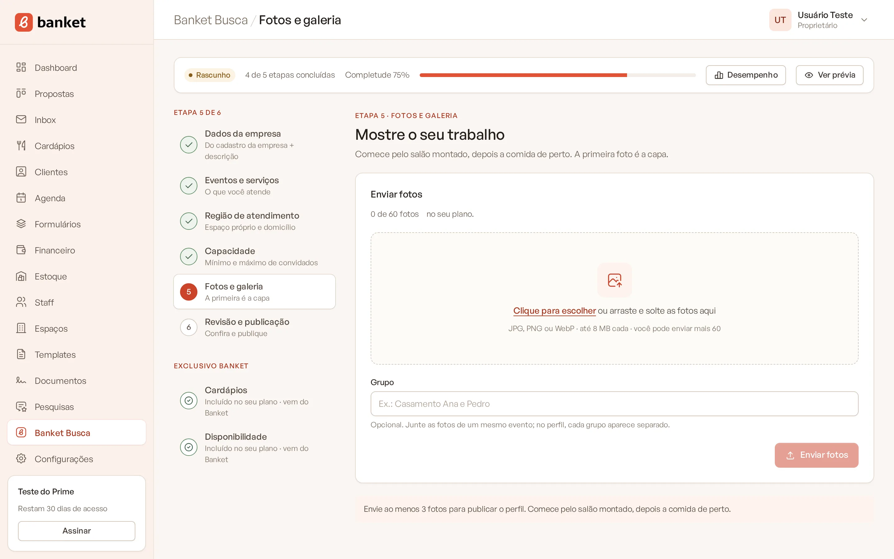
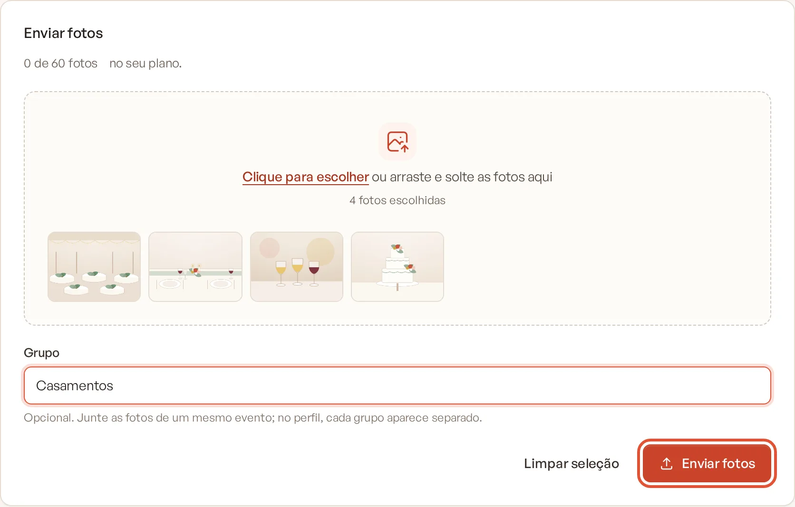
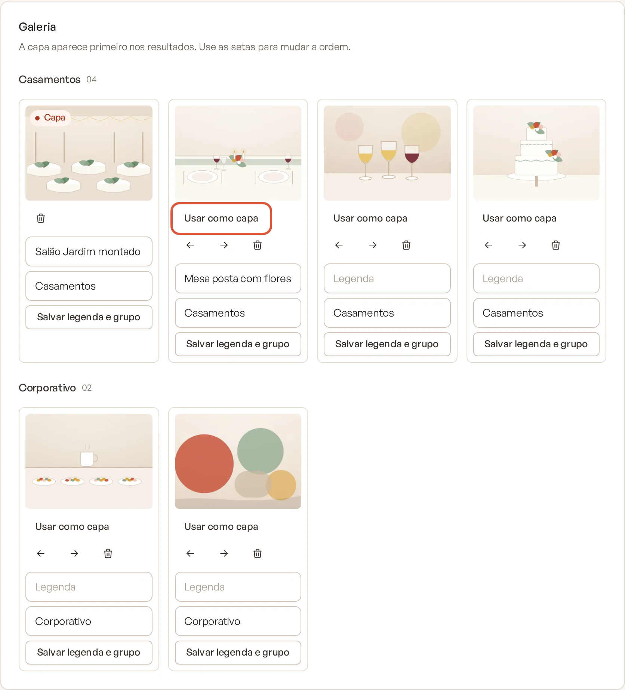
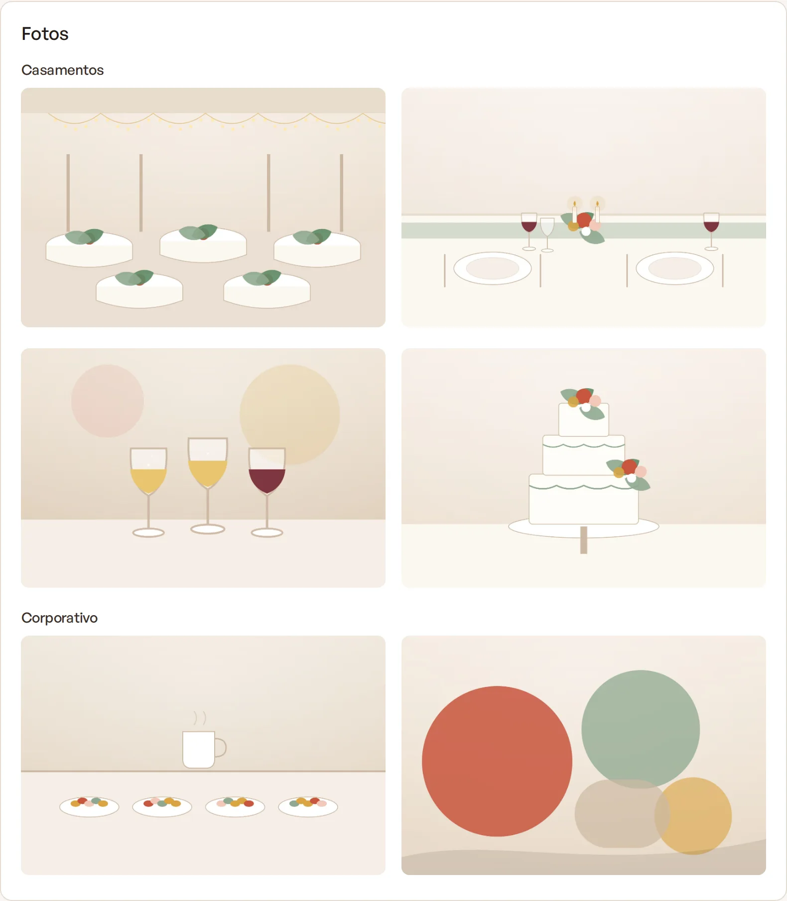

# Etapa 5: fotos

As fotos são o que o cliente vê primeiro. Nesta etapa você envia as imagens do buffet, escolhe a capa, define a ordem e,
nos planos pagos, organiza as fotos em grupos por evento.

> **Disponível em:** todos os planos, com limite de fotos por plano · **Quem pode usar:** Proprietário e Administrador

## Passo a passo

1. No menu lateral, clique em **Banket Busca** e abra a etapa **Fotos e galeria**.
2. No cartão **Enviar fotos**, clique em **Clique para escolher** ou arraste e solte as fotos na área.
   - Aceita JPG, PNG ou WebP, até 8 MB cada. Fotos grandes são reduzidas automaticamente antes do envio.
   - As fotos escolhidas aparecem em miniatura. Use **Limpar seleção** para recomeçar.

   

3. Nos planos pagos, preencha **Grupo** se quiser juntar as fotos de um mesmo evento (por exemplo, "Casamento Ana e
   Pedro"). É opcional.

   

4. Clique em **Enviar fotos**.
5. Na **Galeria**, organize as fotos:
   - **Usar como capa**: define a foto que aparece primeiro, nos resultados e no topo do perfil;
   - setas: mudam a ordem da foto;
   - lixeira: exclui a foto, depois de confirmar;
   - **Legenda**: texto da foto, salvo com **Salvar legenda** (ou **Salvar legenda e grupo**, nos planos pagos).

   

6. Clique em **Continuar** para ir à revisão.

Para concluir a etapa e poder publicar, o perfil precisa de pelo menos 3 fotos.

## Limites do plano

| Plano | Fotos | Grupos por evento |
|---|---|---|
| Busca | 5 fotos gerais | Não |
| Essencial e Profissional | 30 | Sim |
| Prime | 60 | Sim |
| Master | sem limite | Sim |

Ao atingir o limite, aparece o aviso para excluir uma foto antes de enviar outra ou conhecer os planos. Se você escolher
mais fotos do que cabem, só as primeiras entram na seleção.

## Como as fotos aparecem no perfil

- A capa aparece no card dos resultados e como foto principal do perfil.
- O topo do perfil mostra a capa e até 4 miniaturas.
- Nos planos pagos, a seção **Fotos** do perfil mostra cada grupo separado. Fotos sem grupo ficam em "Mais fotos".
- Sem nenhuma foto, o perfil usa uma imagem padrão do Banket Busca.

## Dicas

- Comece pelo salão montado e depois mostre a comida de perto.
- Fotos são o item que mais pesa na completude do perfil, que ajuda na ordem dos resultados.

## Perguntas frequentes

### Algumas fotos aparecem esmaecidas com a etiqueta "Fora do plano". Por quê?
O plano da empresa passou a permitir menos fotos. As fotos acima do limite ficam guardadas, mas não aparecem no perfil
público. Ao voltar para um plano com mais fotos, elas reaparecem.

### Excluí a capa. E agora?
A próxima foto da galeria vira a capa automaticamente. Você pode trocar com **Usar como capa**.

### Excluí uma foto e o perfil voltou a rascunho.
Com menos de 3 fotos a etapa deixa de estar concluída e o perfil sai da busca. Envie novas fotos e publique de novo.

## Artigos relacionados
- [Etapa 4: capacidade](06-etapa-4-capacidade.md)
- [Revisar e publicar o perfil](08-etapa-6-revisar-e-publicar.md)
- [Perfil Simples e Perfil Personalizado](02-perfil-simples-e-personalizado.md)
