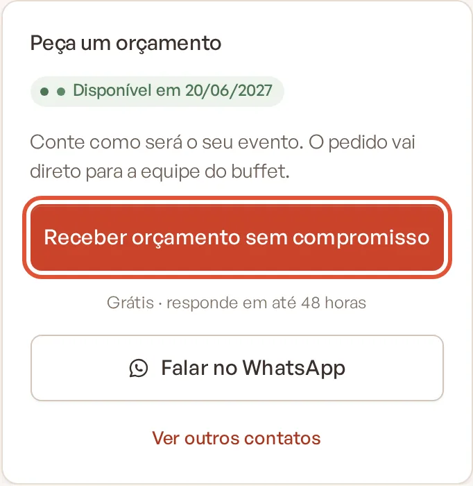
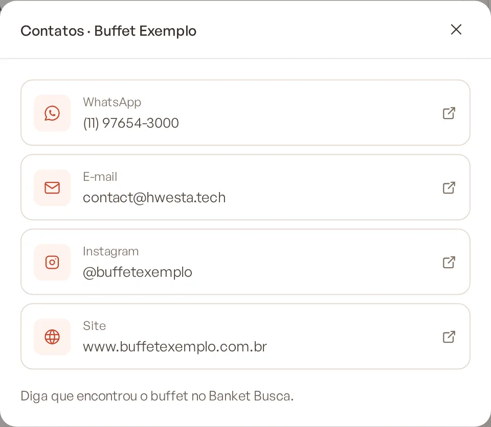
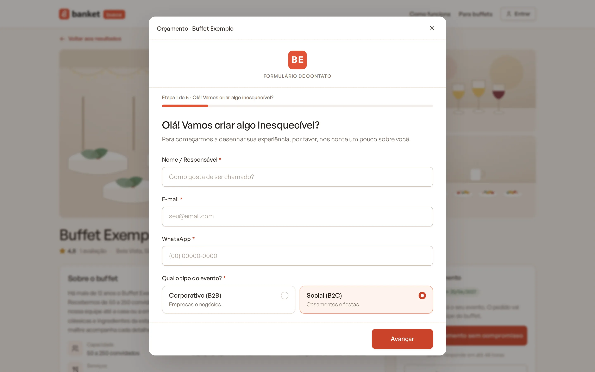
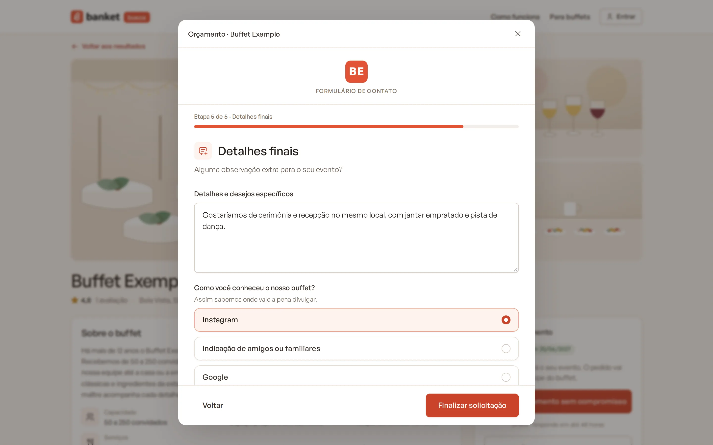
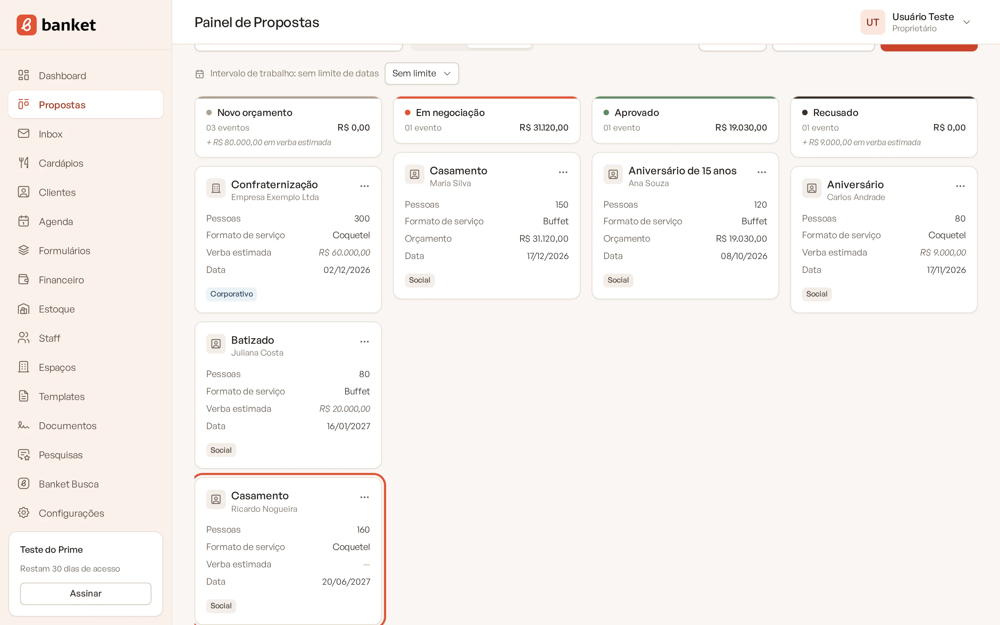
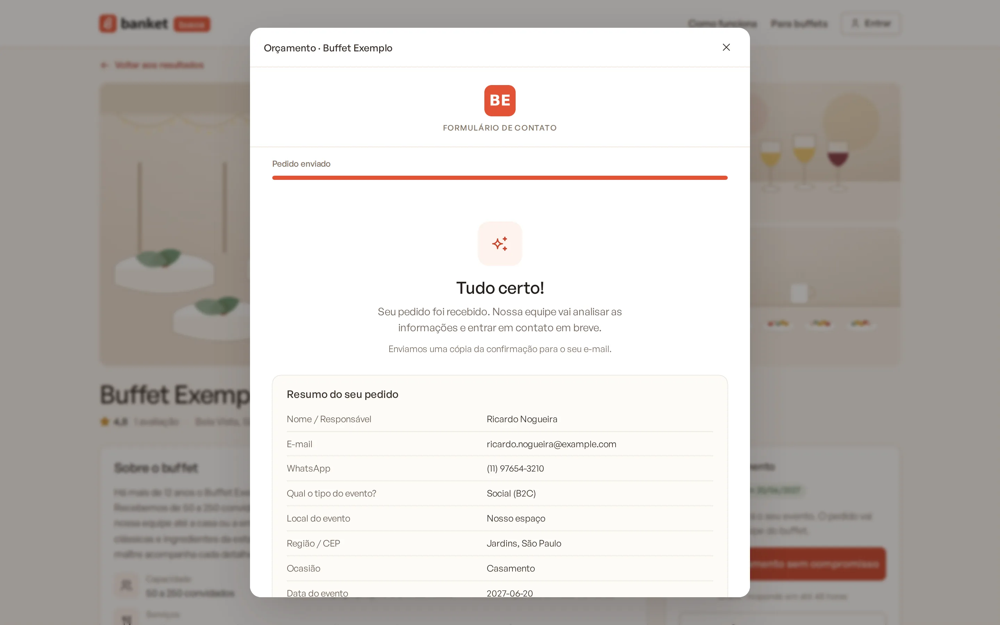
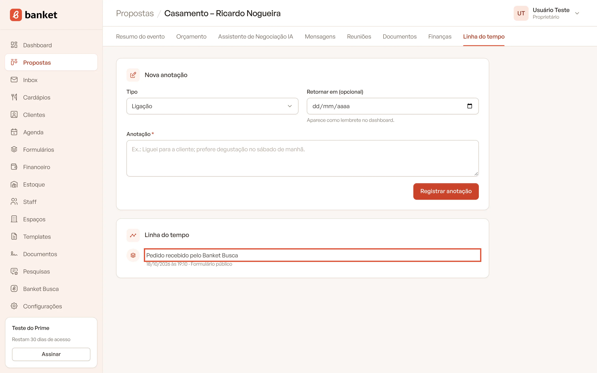

# Receber pedidos pelo Banket Busca

O cliente que encontra o seu buffet na vitrine fala com você pelo perfil. No Perfil Simples, ele vê os seus contatos. No
Perfil Personalizado, ele também pode preencher o seu formulário de orçamento, e o pedido entra direto no **Painel de
Propostas**, já com data, convidados e tipo de evento.

> **Disponível em:** contatos em todos os planos · pedido pelo formulário nos planos Essencial, Profissional, Prime e
> Master · **Quem pode usar:** Proprietário e Administrador recebem o aviso; todos os usuários veem o pedido no Painel de
> Propostas

## O que o cliente vê no perfil

### Perfil Personalizado com formulário ativo
No quadro **Peça um orçamento**, o cliente encontra:

- **Receber orçamento sem compromisso** (no celular, **Obter orçamento**): abre o seu formulário numa janela, sem sair do
  perfil. O tipo de evento, a data e o número de convidados da busca já vêm preenchidos.
- **Falar no WhatsApp**: abre a conversa com uma mensagem pronta, por exemplo "Olá! Encontrei o Buffet Exemplo no Banket
  Busca e gostaria de um orçamento para casamento em 20/06/2027, com 150 convidados."
- **Ver outros contatos**: telefone, e-mail, Instagram e site.

### Perfil Simples (ou Personalizado sem formulário ativo)
No quadro **Fale com o buffet**, o botão **Ver contatos** mostra WhatsApp, telefone, e-mail, Instagram e site. O cliente
fala com você direto por esses canais.

## Qual formulário abre no perfil

O perfil usa o formulário marcado com **Usar no Banket Busca** em **Formulários**. Sem marcação, vale o formulário ativo
mais antigo. Se a empresa não tiver nenhum formulário ativo, o perfil mostra só os contatos. Veja
[Formulário no Banket Busca](../10-formularios/05-formulario-no-banket-busca.md).

## O que acontece quando o cliente envia o formulário

1. O sistema cria (ou reaproveita, pelo e-mail) o cliente e cria o evento na coluna de entrada do **Painel de
   Propostas**, com as respostas do formulário no briefing.

   

2. A linha do tempo do evento registra "Pedido recebido pelo Banket Busca".
3. Proprietários e administradores recebem o e-mail "Novo pedido pelo Banket Busca", com o link para o evento.
4. Se os avisos no WhatsApp estiverem ativos para novos pedidos, a empresa também recebe o aviso no WhatsApp. Veja
   [Avisos no WhatsApp](../19-configuracoes/04-avisos-no-whatsapp.md).
5. O cliente recebe um e-mail de confirmação: "Recebemos o seu pedido".

   

A partir daí, o pedido segue como qualquer outro: orçamento, proposta, envio e acompanhamento.

## Responda dentro do prazo

O perfil mostra o seu tempo de resposta, por exemplo "Responde em até 48 horas". Conta como resposta o primeiro e-mail
enviado ao cliente pelo evento ou a primeira ação no evento, como mudar a etapa, criar o orçamento, agendar uma reunião
ou registrar uma anotação. Cumprir o prazo ajuda o buffet a subir na ordem dos resultados. Veja
[Tempo de resposta aos pedidos](../19-configuracoes/03-tempo-de-resposta-aos-pedidos.md).

## Avaliações no perfil

As notas e os depoimentos do perfil vêm das pesquisas de satisfação respondidas pelos clientes depois do evento. Veja
[Avaliação no Banket Busca](../17-pesquisas/07-avaliacao-no-banket-busca.md).

## Perguntas frequentes

### No plano Busca eu recebo os pedidos no Painel de Propostas?
Não. No Perfil Simples o cliente vê os seus contatos e fala com você direto pelo WhatsApp, telefone ou e-mail. Os
cliques nos contatos aparecem em **Desempenho**.

### Como sei que um evento veio do Banket Busca?
A linha do tempo do evento mostra "Pedido recebido pelo Banket Busca", e o e-mail de aviso cita o perfil que recebeu o
pedido.

### Sou plano pago, mas o perfil só mostra "Ver contatos".
A empresa não tem um formulário ativo. Ative um formulário em **Formulários** e, se tiver mais de um, marque qual usar no
Banket Busca.

## Artigos relacionados
- [Formulário no Banket Busca](../10-formularios/05-formulario-no-banket-busca.md)
- [Como o pedido vira evento](../10-formularios/04-como-o-pedido-vira-evento.md)
- [Painel de Propostas](../03-propostas-e-eventos/01-painel-de-propostas.md)
- [Desempenho do perfil](12-desempenho-do-perfil.md)
- [Tempo de resposta aos pedidos](../19-configuracoes/03-tempo-de-resposta-aos-pedidos.md)
