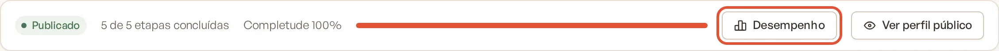
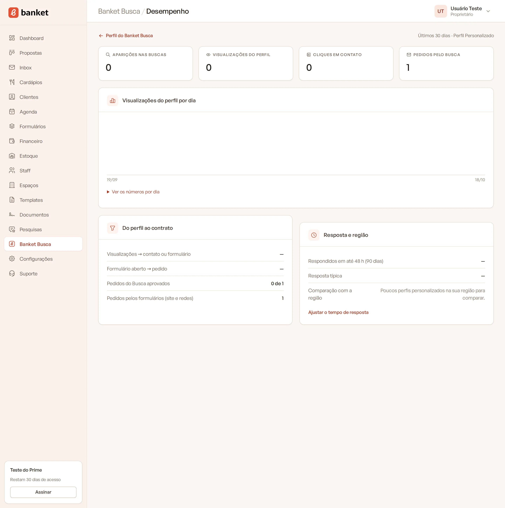

# Desempenho do perfil

A tela **Desempenho** mostra como o seu perfil foi visto no Banket Busca nos últimos 30 dias: quantas vezes apareceu nas
buscas, quantas pessoas abriram o perfil, quantas abriram os seus contatos e, no Perfil Personalizado, quantos pedidos
chegaram e quantos viraram contrato.

> **Disponível em:** todos os planos (detalhes completos nos planos pagos) · **Quem pode usar:** todos os usuários

## Como abrir

1. No menu lateral, clique em **Banket Busca**.
2. No topo da página, clique em **Desempenho**.

   

Para voltar, use **Perfil do Banket Busca**.

## Os indicadores

| Indicador | O que conta |
|---|---|
| Aparições nas buscas | Quantas vezes o card do buffet apareceu nos resultados. |
| Visualizações do perfil | Quantas vezes o perfil foi aberto. |
| Cliques em contato | Quantas vezes alguém abriu os seus contatos ou tocou num canal (WhatsApp, telefone, e-mail, Instagram, site). |
| Pedidos pelo Busca | Pedidos enviados pelo seu formulário a partir do perfil (Perfil Personalizado). |

A mesma pessoa abrindo o perfil ou os contatos várias vezes em pouco tempo conta uma vez só. Robôs de busca não contam.
A sua prévia também não conta.

## No Perfil Simples

Você vê os três primeiros indicadores e o cartão **O que você deixou de ganhar**, com a média de pedidos que os perfis
personalizados da sua cidade (ou do seu estado) receberam no período, quando há perfis suficientes para comparar. O
botão **Testar o Perfil Personalizado por 30 dias** (ou **Conhecer o Perfil Personalizado**, se a empresa já usou o
teste) leva aos planos.

## No Perfil Personalizado

Além dos indicadores, você vê:

- **Visualizações do perfil por dia**: gráfico dos 30 dias. Em **Ver os números por dia**, a tabela com aparições,
  visualizações, contatos e formulários abertos de cada dia.
- **Do perfil ao contrato**:
  - Visualizações → contato ou formulário: quanto das visitas virou contato;
  - Formulário aberto → pedido: quanto dos formulários abertos foi enviado;
  - Pedidos do Busca aprovados: quantos pedidos chegaram à etapa de aprovado;
  - Pedidos pelos formulários (site e redes): pedidos dos seus formulários que não vieram do Banket Busca.
- **Resposta e região**:
  - Respondidos em até X h (90 dias): quanto dos pedidos você respondeu dentro do seu tempo de resposta;
  - Resposta típica: o tempo que você costuma levar para responder;
  - médias de visualizações e pedidos dos perfis personalizados da região, quando há perfis suficientes para comparar;
  - o link **Ajustar o tempo de resposta**.

## Perguntas frequentes

### Os números estão zerados. O perfil está funcionando?
Confira se o perfil está **Publicado**. Rascunhos não aparecem na busca. Depois, confira se os tipos de evento, a região
e a capacidade combinam com o que os clientes procuram.

### Por que a comparação com a região não aparece?
Ela só aparece quando há perfis personalizados suficientes na sua cidade ou no seu estado. Sem isso, aparece "Poucos
perfis personalizados na sua região para comparar."

## Artigos relacionados
- [Receber pedidos pelo Banket Busca](11-receber-pedidos-pelo-busca.md)
- [Como os resultados são ordenados](13-como-os-resultados-sao-ordenados.md)
- [Tempo de resposta aos pedidos](../19-configuracoes/03-tempo-de-resposta-aos-pedidos.md)
