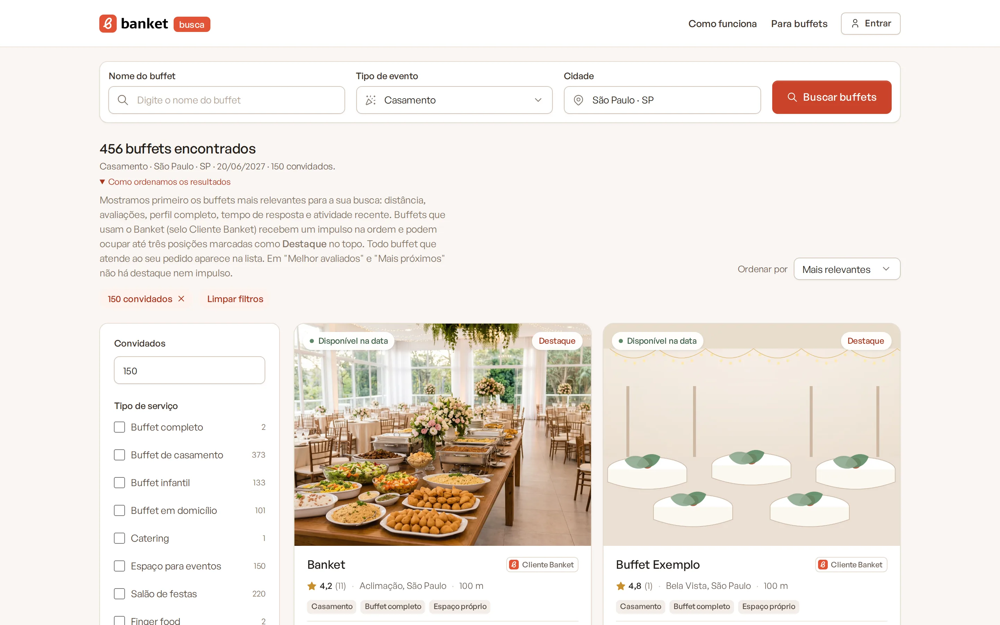
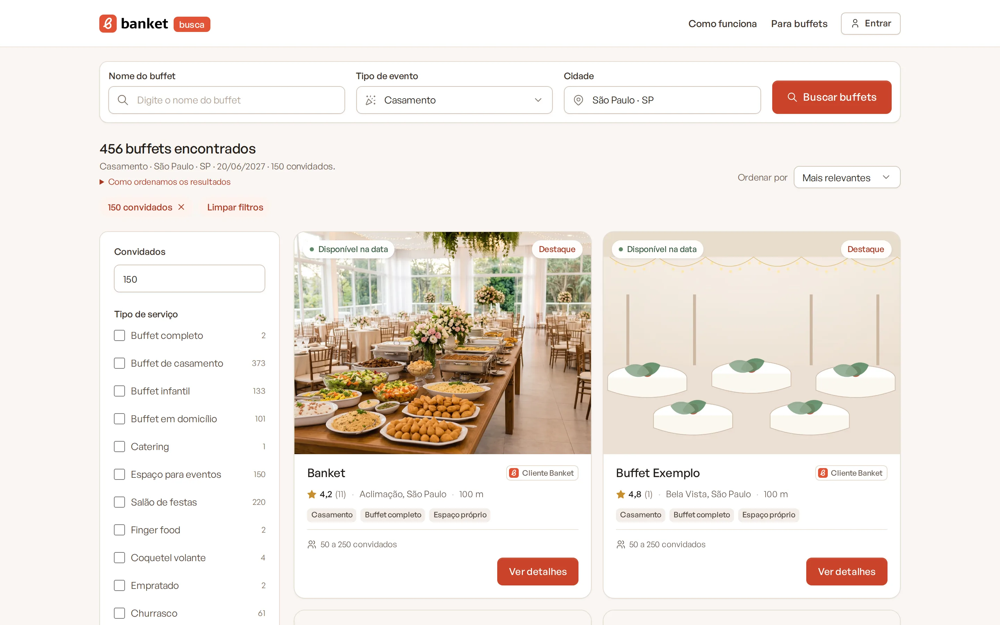

# Como os resultados são ordenados

Quando o cliente faz uma busca, o Banket Busca primeiro escolhe os buffets que atendem ao pedido e depois os coloca em
ordem, dos mais relevantes para os menos relevantes. Este artigo explica as duas partes para você entender o que fazer
para o perfil aparecer mais e melhor.

> **Disponível em:** todos os planos · **Quem pode usar:** informação para todos os usuários

## 1. Em quais buscas o buffet aparece

Todo buffet publicado que atende ao pedido aparece na lista. O perfil entra quando:

- o **tipo de evento** buscado está entre os que você marcou;
- a **cidade** buscada está na sua região: a cidade do buffet, uma das outras cidades atendidas, o raio do atendimento
  em domicílio ou uma distância razoável do seu espaço próprio;
- o **número de convidados** está entre o seu mínimo e o seu máximo (ou abaixo do mínimo, se você aceita eventos menores
  sob consulta);
- a **data** não está ocupada na sua agenda. Isso só vale para o Perfil Personalizado, que mostra a disponibilidade; no
  Perfil Simples a data nunca tira o buffet da lista.

Se o cliente usar filtros (serviço, opção de cardápio, modo de atendimento, nota, distância), o perfil também precisa
combinar com eles.

## 2. A ordem dos resultados

Na ordem padrão (**Mais relevantes**), a vitrine explica ao cliente, em "Como ordenamos os resultados":

> Mostramos primeiro os buffets mais relevantes para a sua busca: distância, avaliações, perfil completo, tempo de
> resposta e atividade recente. Buffets que usam o Banket (selo Cliente Banket) recebem um impulso na ordem e podem
> ocupar até três posições marcadas como **Destaque** no topo. Todo buffet que atende ao seu pedido aparece na lista. Em
> "Melhor avaliados" e "Mais próximos" não há destaque nem impulso.

Os critérios valem igualmente para todos os buffets:

| Critério | O que conta | Como melhorar |
|---|---|---|
| Distância | Quanto o buffet está perto da cidade buscada. | Mantenha a cidade e a região de atendimento corretas. |
| Avaliações | A nota média e a quantidade de avaliações. | Envie a pesquisa de satisfação depois de cada evento. |
| Perfil completo | A completude do perfil. | Descrição longa, logotipo, fotos, contatos, Instagram ou site. |
| Tempo de resposta | Quanto dos pedidos você responde dentro do prazo que divulga. | Escolha um prazo que você cumpre e responda rápido. |
| Atividade recente | Perfil atualizado ou pedido respondido recentemente. | Revise o perfil de tempos em tempos e responda aos pedidos. |

## Destaque e impulso dos planos pagos

- Buffets com Perfil Personalizado (planos pagos) levam o selo **Cliente Banket** e recebem um impulso na ordem. O
  impulso é maior para perfis completos e perto de quem busca.
- As primeiras posições da primeira página podem ser marcadas como **Destaque**. Elas vão para buffets com Perfil
  Personalizado que já são relevantes para a busca. Um perfil incompleto ou distante não ganha o destaque só por ser
  pago.
- No restante da lista, buffets com e sem plano pago se intercalam.
- Quando dois buffets ficam praticamente empatados, eles se revezam na ordem de um dia para o outro.

## Outras ordens

O cliente pode trocar a ordem em **Ordenar por**:

- **Melhor avaliados**: pela nota, sem destaque nem impulso;
- **Mais próximos**: pela distância, sem destaque nem impulso.

## Perguntas frequentes

### Pagar garante o primeiro lugar?
Não. O plano pago dá o impulso e a chance de ocupar uma vaga de Destaque, mas a ordem depende também da distância, das
avaliações, da completude, do tempo de resposta e da atividade.

### O buffet sem plano pago aparece na busca?
Sim. Todo buffet publicado que atende ao pedido aparece na lista.

### O que posso fazer hoje para subir?
Complete o perfil (veja a **Completude** no topo do menu **Banket Busca**), envie pelo menos 5 boas fotos, escreva uma
descrição com mais de 300 caracteres e responda aos pedidos dentro do prazo.

## Artigos relacionados
- [Revisar e publicar o perfil](08-etapa-6-revisar-e-publicar.md)
- [Etapa 3: região de atendimento](05-etapa-3-regiao-de-atendimento.md)
- [Desempenho do perfil](12-desempenho-do-perfil.md)
- [Avaliação no Banket Busca](../17-pesquisas/07-avaliacao-no-banket-busca.md)
- [Tempo de resposta aos pedidos](../19-configuracoes/03-tempo-de-resposta-aos-pedidos.md)
