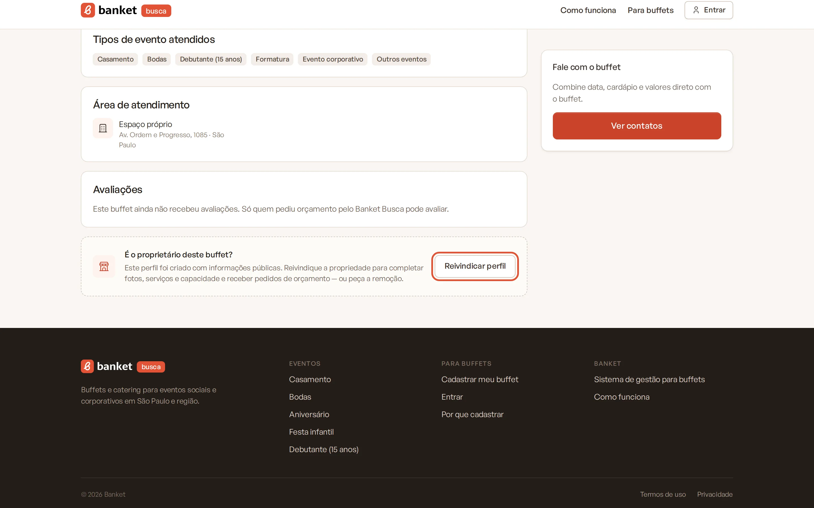
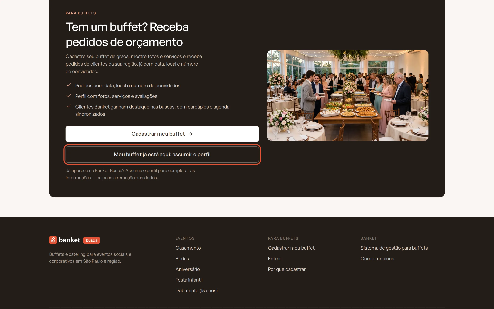
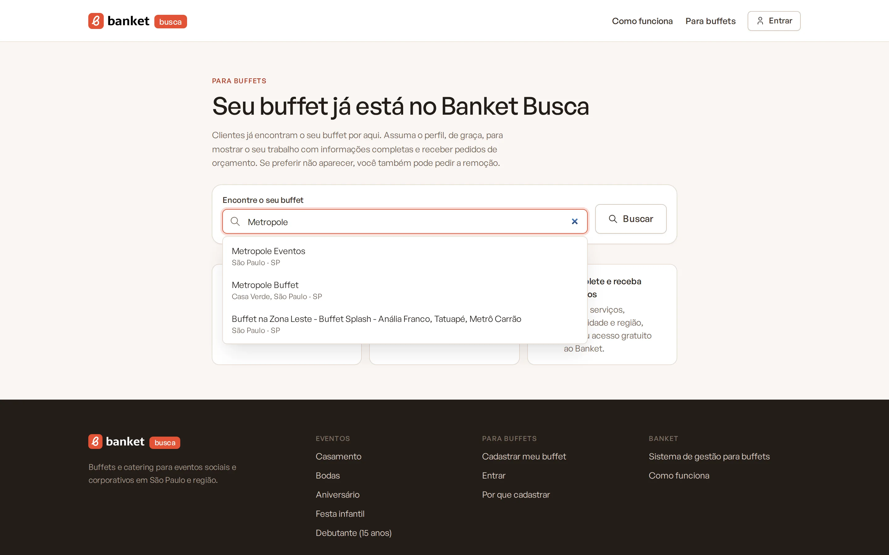
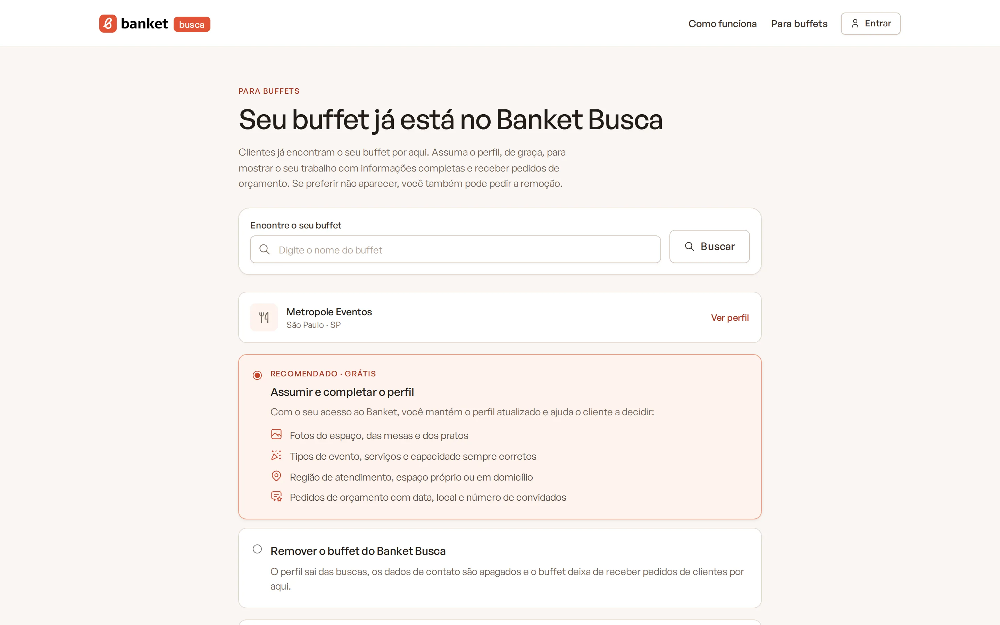
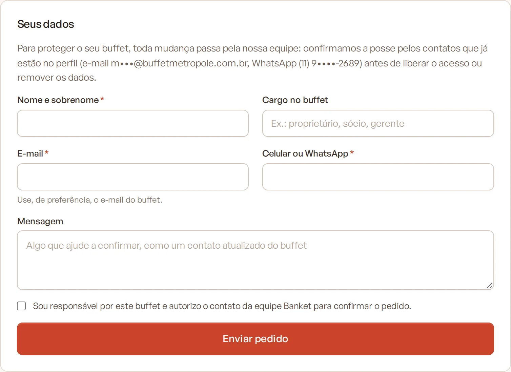

# Reivindicar o perfil do seu buffet

Alguns buffets já aparecem no Banket Busca com um perfil montado a partir de informações públicas. Se o seu é um deles,
você pode **assumir o perfil**, de graça, para completar fotos, serviços e capacidade e receber pedidos de orçamento. Se
preferir não aparecer, pode **pedir a remoção**.

> **Disponível em:** gratuito (o perfil assumido começa no plano Busca) · **Quem pode usar:** o responsável pelo buffet

## Como encontrar o perfil

Você pode começar por qualquer um destes caminhos:

- no perfil do buffet na vitrine, no quadro **É o proprietário deste buffet?**, clique em **Reivindicar perfil**;

  

- na página inicial da vitrine, clique em **Meu buffet já está aqui: assumir o perfil** e procure o buffet pelo nome em
  **Encontre o seu buffet**.

  

  

Se o perfil já é administrado pelo próprio buffet, aparece o aviso de que ele já tem responsável, com o link para entrar
na conta.

## Passo a passo do pedido

1. Na página do buffet, escolha uma opção:
   - **Assumir e completar o perfil** (recomendado, grátis);
   - **Remover o buffet do Banket Busca**.

   

2. Em **Seus dados**, preencha:
   - **Nome e sobrenome** (obrigatório);
   - **Cargo no buffet** (por exemplo, proprietário, sócio, gerente);
   - **E-mail** (obrigatório; de preferência, o e-mail do buffet);
   - **Celular ou WhatsApp** com DDD (obrigatório);
   - **Mensagem**, com algo que ajude a confirmar, como um contato atualizado do buffet.
3. Marque **Sou responsável por este buffet e autorizo o contato da equipe Banket para confirmar o pedido.**
4. Clique em **Enviar pedido**.

   

5. Aparece **Pedido recebido** e você recebe um e-mail de confirmação.

## Como a equipe confirma

Para proteger o buffet, toda mudança passa pela equipe do Banket. A equipe confirma que você é o responsável usando os
contatos que já estão no perfil (os canais aparecem parcialmente na tela) e responde em até 2 dias úteis no e-mail
informado.

- **Pedido para assumir aprovado**: você recebe o e-mail "Pronto: o perfil do ... é seu", com o botão **Criar meu acesso
  e assumir o perfil**. O link vale por 72 horas.
- **Pedido de remoção aprovado**: o perfil sai do Banket Busca, os dados de contato são apagados e você recebe um e-mail
  avisando. O buffet não volta a ser incluído depois.
- **Pedido recusado**: você recebe um e-mail com o motivo.

## Criar o acesso e assumir o perfil

1. Abra o link do e-mail.
2. Se você ainda não tem conta no Banket, preencha **Nome e sobrenome**, **Senha** e **Confirme a senha**, aceite os
   Termos de uso e a Política de privacidade e clique em **Criar acesso e assumir o perfil**.
3. Se já tem conta com esse e-mail, informe a **Senha** e clique em **Entrar e assumir o perfil**. Esqueceu a senha? Use
   o link **Esqueceu a senha?**.
4. Você entra como Proprietário da empresa e cai no menu **Banket Busca**, com a mensagem "O perfil agora é seu.
   Complete as informações para aparecer melhor nas buscas."

Se a empresa tiver mais de uma unidade no Banket Busca, você passa a responder por todas.

## Depois de assumir

- O perfil continua publicado enquanto você completa as etapas. A completude pesa na ordem dos resultados, então vale
  completar logo.
- Se você despublicar o perfil, as regras normais passam a valer: para publicar de novo, conclua as etapas 1 a 5.
- A empresa começa no plano Busca, com o Perfil Simples. Você pode testar um plano pago a qualquer momento.

## Perguntas frequentes

### O link do e-mail não funciona mais.
Ele vale por 72 horas e só pode ser usado uma vez. Responda o e-mail da equipe para receber um link novo.

### Já existe um pedido em análise para o meu buffet.
Se foi você, aguarde o contato da equipe. Se não foi, envie o seu pedido com um contato que ajude a confirmar.

### Apareceu "Muitos pedidos em pouco tempo. Tente de novo mais tarde."
Há um limite de pedidos por período. Aguarde um pouco e envie de novo.

## Artigos relacionados
- [O que é o Banket Busca](01-o-que-e-o-banket-busca.md)
- [Etapa 1: dados da empresa](03-etapa-1-dados-da-empresa.md)
- [Revisar e publicar o perfil](08-etapa-6-revisar-e-publicar.md)
- [Teste grátis de 30 dias](../20-planos-e-assinatura/02-teste-gratis-de-30-dias.md)
