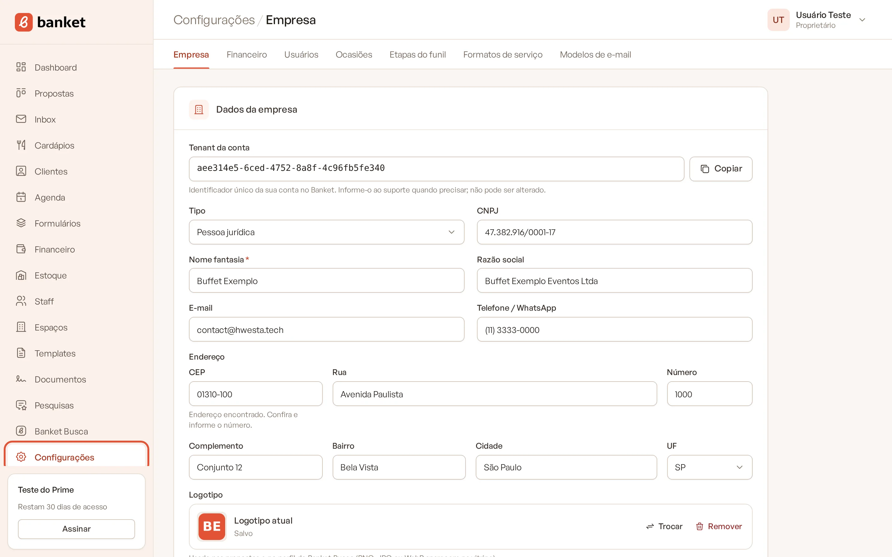
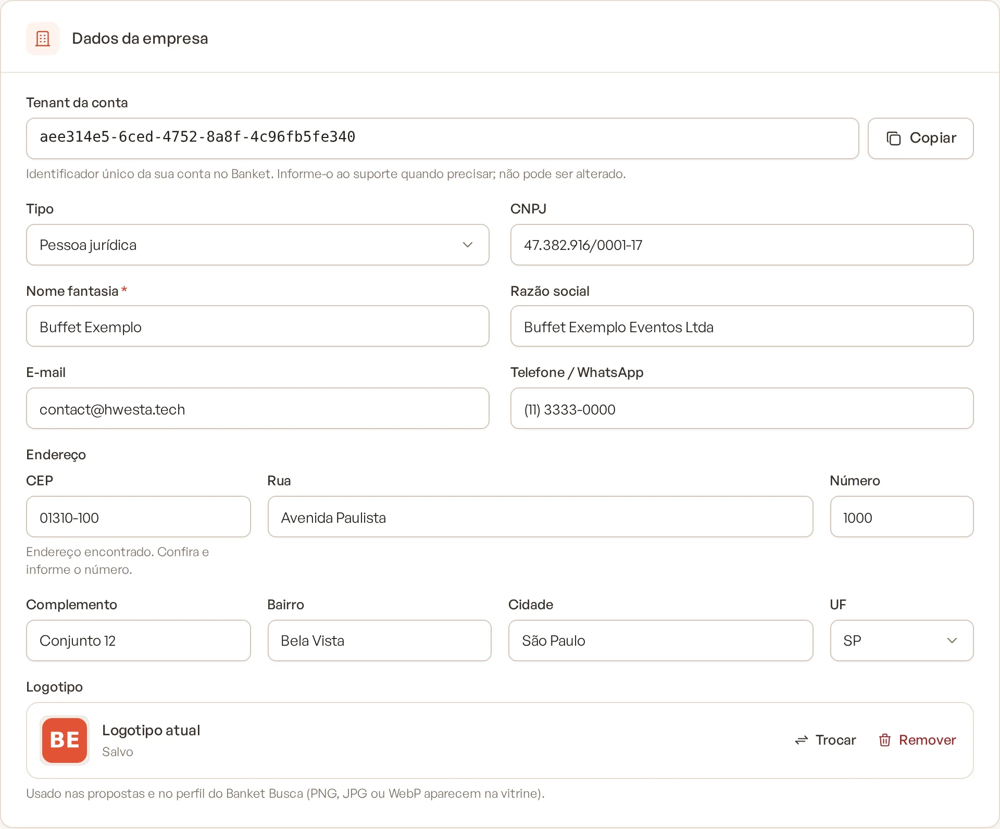
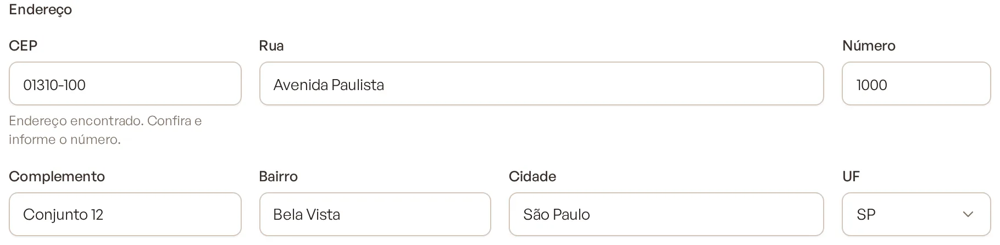
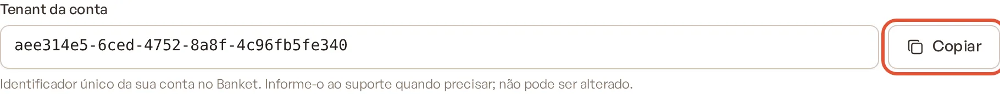
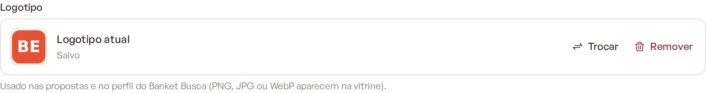

# Dados da empresa

Os dados cadastrais da empresa aparecem nas propostas, nos documentos e contratos, na cobrança da assinatura e no
perfil do Banket Busca. Mantenha-os sempre atualizados em **Configurações › Empresa**.

> **Disponível em:** todos os planos, inclusive o Busca · **Quem pode usar:** Proprietário e Administrador

## Passo a passo

1. No menu lateral, clique em **Configurações**. A tela **Empresa** abre primeiro.

   

2. No card **Dados da empresa**, preencha:
   - **Tipo**: **Pessoa jurídica** ou **Pessoa física**;
   - **CNPJ** ou **CPF** (o rótulo muda conforme o tipo);
   - **Nome fantasia** (obrigatório);
   - **Razão social** (só para pessoa jurídica);
   - **E-mail** e **Telefone / WhatsApp**;
   - **Endereço** (veja abaixo);
   - **Logotipo**.

   

3. Clique em **Salvar**, no fim da página.

## Endereço pelo CEP

1. Digite o **CEP** (primeiro campo do endereço).
2. O sistema busca o endereço e preenche **Rua**, **Bairro**, **Cidade** e **UF**, substituindo o que estava nesses
   campos. Aparece a mensagem "Endereço encontrado. Confira e informe o número."

   

3. Preencha o **Número** e, se precisar, o **Complemento** (sala, bloco, referência).

Se o CEP não for encontrado, preencha o endereço à mão.

## Tenant da conta

No topo do card aparece o **Tenant da conta**: o identificador único da sua empresa no Banket. Ele não pode ser
alterado. Clique em **Copiar** e informe esse código quando falar com o suporte.

## Logotipo

Arraste o arquivo ou clique para procurar. O logotipo é usado nas propostas e no perfil do Banket Busca. Para aparecer
na vitrine do Busca, use PNG, JPG ou WebP. Para tirar o logotipo, clique em **Remover** e depois em **Salvar**.

## O que acontece depois

- **Banket Busca**: ao salvar, o nome, o CPF/CNPJ, o e-mail, o telefone e o logotipo são copiados para o seu perfil no
  Busca. Por isso o cadastro do perfil não pede esses dados de novo.
- **Assinatura**: para contratar um plano pago, a empresa precisa de CPF ou CNPJ válido (e razão social, se for
  pessoa jurídica).
- **Documentos**: as variáveis da empresa nos contratos (nome, razão social, CNPJ, endereço) usam estes dados.

## O que mais fica nesta tela

A mesma página reúne outros ajustes, explicados em artigos próprios:
- [Parâmetros comerciais](02-parametros-comerciais.md) (validade da proposta, crianças, espaço padrão, assinatura);
- [Tempo de resposta aos pedidos](03-tempo-de-resposta-aos-pedidos.md);
- [Avisos no WhatsApp](04-avisos-no-whatsapp.md).

No plano Busca, a página mostra só os dados da empresa, o tempo de resposta e os avisos no WhatsApp (bloqueados); os
parâmetros da proposta ficam ocultos.

## Perguntas frequentes

### Apareceu "CPF/CNPJ inválido". O que faço?
Confira os dígitos e se o **Tipo** está certo: CPF é para pessoa física e CNPJ para pessoa jurídica.

### Posso cadastrar duas empresas com o mesmo CNPJ?
Não. Cada CPF ou CNPJ pertence a uma única empresa no Banket. Se a sua empresa já existe, peça um convite a quem a
administra.

### Mudei o logotipo aqui. O template da proposta muda também?
Não. O template tem o seu próprio logotipo, no card **Identidade visual**. Veja
[Criar e editar um template da proposta](../15-templates/01-criar-template.md).

## Artigos relacionados
- [Parâmetros comerciais](02-parametros-comerciais.md)
- [Etapa 1: dados da empresa no Banket Busca](../18-banket-busca/03-etapa-1-dados-da-empresa.md)
- [Contratar assinatura](../20-planos-e-assinatura/03-contratar-assinatura.md)
