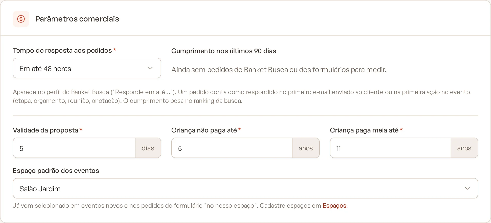
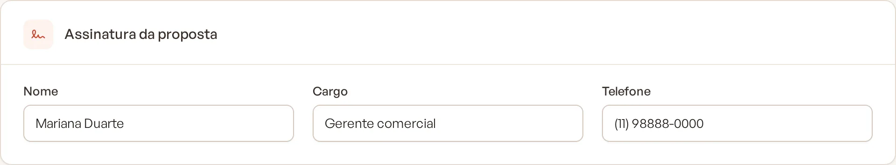
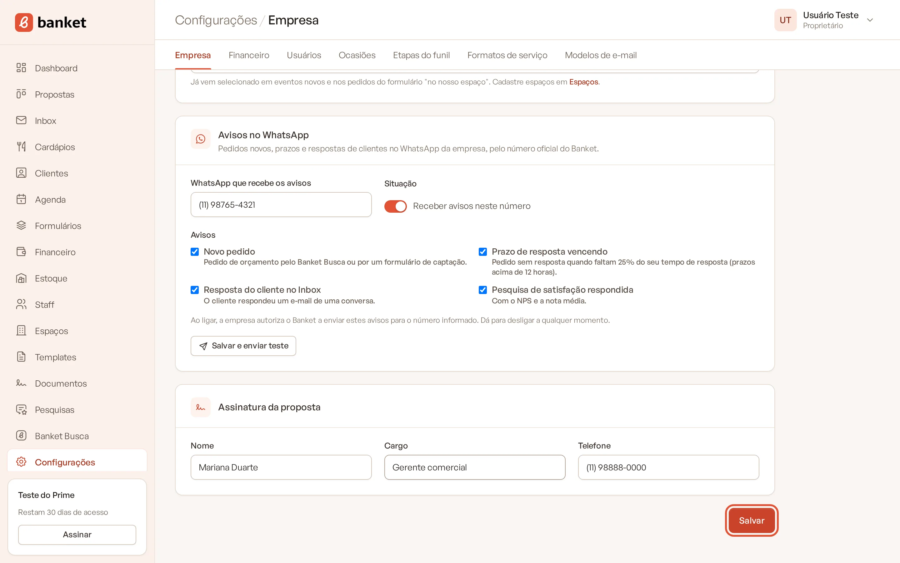

# Parâmetros comerciais e assinatura da proposta

Os parâmetros comerciais são regras usadas em todos os orçamentos: por quantos dias a proposta vale, como as crianças
são cobradas e qual espaço já vem escolhido nos eventos novos. Na mesma tela você define quem assina a proposta.

> **Disponível em:** planos Essencial, Profissional, Prime e Master · **Quem pode usar:** Proprietário e Administrador

## Passo a passo

1. No menu lateral, clique em **Configurações**. A tela **Empresa** abre primeiro.
2. Desça até o card **Parâmetros comerciais** e preencha os campos (veja a tabela abaixo).

   

3. No card **Assinatura da proposta**, preencha **Nome**, **Cargo** e **Telefone** de quem assina.

   

4. Clique em **Salvar**, no fim da página.

   

## Entenda os campos

| Campo | O que faz |
|---|---|
| Validade da proposta (dias) | Prazo de validade da proposta. Entra como a linha "Prazo de validade da proposta: N dias corridos" nas condições gerais de cada orçamento novo. Obrigatório, a partir de 1. Padrão: 5 dias. |
| Criança não paga até (anos) | Crianças até esta idade são isentas. Padrão: 5 anos. |
| Criança paga meia até (anos) | Crianças acima da idade de isenção e até esta idade pagam meia. Padrão: 11 anos. Precisa ser maior ou igual à idade de isenção. |
| Espaço padrão dos eventos | Espaço que já vem selecionado em eventos novos e nos pedidos do formulário em que o cliente escolhe "no nosso espaço". Pode ser **Nenhum**. |
| Assinatura da proposta | Nome, cargo e telefone que aparecem como assinante da proposta e nos documentos. |

O card **Parâmetros comerciais** também traz o **Tempo de resposta aos pedidos**, explicado em
[Tempo de resposta aos pedidos](03-tempo-de-resposta-aos-pedidos.md).

## Como as idades entram no cálculo

No orçamento, os campos de convidados mostram as idades definidas aqui: **Crianças meia (até N anos)** e
**Crianças isentas (até N anos)**. Você informa quantas crianças há em cada faixa, e o valor por pessoa é multiplicado
pelos **pagantes equivalentes**:

> convidados − crianças isentas − crianças de meia + (crianças de meia × 0,5)

Exemplo: 100 convidados, com 6 crianças isentas e 10 de meia → 100 − 6 − 10 + 5 = **89 pagantes equivalentes**.

A lista de compras, por outro lado, usa todos os convidados, porque as crianças também comem.

## Perguntas frequentes

### Mudei a validade. Os orçamentos já criados mudam?
Não. A nova validade entra nos orçamentos criados depois da mudança. Num orçamento já existente, ajuste a linha
direto nas condições gerais do orçamento.

### O espaço padrão não aparece na lista. Por quê?
A lista mostra os espaços cadastrados no menu **Espaços**. Cadastre o espaço primeiro. Veja
[Cadastrar espaço](../14-espacos/01-cadastrar-espaco.md).

### Não vejo estes campos na tela Empresa.
No plano Busca, os parâmetros da proposta ficam ocultos, porque o plano não tem orçamentos. Eles aparecem ao
contratar um plano pago.

## Artigos relacionados
- [Como o valor é calculado](../04-orcamento/13-como-o-valor-e-calculado.md)
- [Dados da empresa](01-dados-da-empresa.md)
- [Cadastrar espaço](../14-espacos/01-cadastrar-espaco.md)
