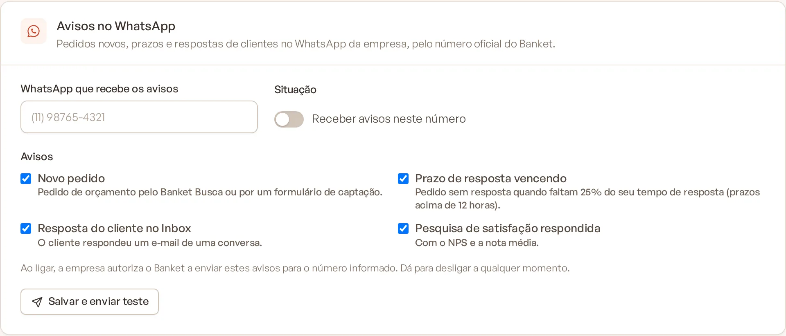
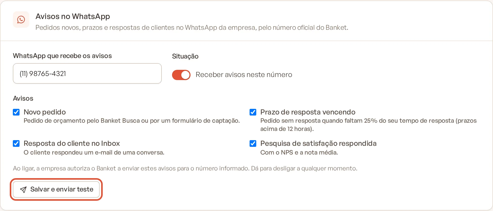

# Avisos no WhatsApp

O Banket pode avisar a sua empresa pelo WhatsApp, a partir do número oficial do Banket, quando chega um pedido novo,
quando o prazo de resposta está vencendo, quando um cliente responde um e-mail e quando uma pesquisa de satisfação é
respondida. Cada aviso traz um botão que abre a tela certa no Banket.

> **Disponível em:** planos Essencial, Profissional, Prime e Master (Perfil Personalizado) · **Quem pode usar:**
> Proprietário e Administrador

No plano Busca, o card **Avisos no WhatsApp** aparece com cadeado e o link **Ver planos**.

## Passo a passo

1. No menu lateral, clique em **Configurações**. A tela **Empresa** abre primeiro.
2. Desça até o card **Avisos no WhatsApp**.

   

3. Em **WhatsApp que recebe os avisos**, digite um celular com DDD, por exemplo (11) 98765-4321.
4. Ligue **Receber avisos neste número**.
5. Em **Avisos**, marque os tipos que deseja receber (veja abaixo).
6. Clique em **Salvar e enviar teste** para salvar e receber uma mensagem de teste no número informado. Ou clique em
   **Salvar**, no fim da página, para só salvar.

   

Ao ligar os avisos, a empresa autoriza o Banket a enviar essas mensagens para o número informado. Dá para desligar a
qualquer momento.

## Tipos de aviso

| Aviso | Quando chega |
|---|---|
| Novo pedido | Pedido de orçamento pelo Banket Busca ou por um formulário de captação. |
| Prazo de resposta vencendo | O pedido ainda não foi respondido e faltam 25% do seu [tempo de resposta](03-tempo-de-resposta-aos-pedidos.md). Só vale para prazos acima de 12 horas (exemplo: com prazo de 48 horas, o aviso chega 36 horas depois do pedido). |
| Resposta do cliente no Inbox | O cliente respondeu um e-mail de uma conversa. |
| Pesquisa de satisfação respondida | Um cliente respondeu a pesquisa, com o NPS e a nota média. |

Cada aviso é enviado uma única vez por pedido, mensagem ou pesquisa.

## Últimos avisos

Abaixo do botão de teste, a tela lista os últimos 5 avisos enviados, com o tipo, a data e a situação:

| Situação | Significado |
|---|---|
| Pendente | O aviso está na fila de envio. |
| Enviada | O WhatsApp recebeu a mensagem. |
| Entregue | A mensagem chegou ao celular. |
| Lida | A mensagem foi lida. |
| Falhou | A mensagem não foi enviada. O motivo aparece logo abaixo. |

Se a tela mostrar "A conexão com o WhatsApp ainda está sendo configurada: por enquanto os avisos ficam só
registrados.", os avisos aparecem na lista, mas ainda não chegam ao celular.

## Perguntas frequentes

### Apareceu "Informe um celular com DDD". O que faço?
O número precisa ser um celular brasileiro com DDD. Telefones fixos não recebem os avisos.

### Cliquei em "Salvar e enviar teste" e apareceu que a mensagem não foi enviada.
Os dados foram salvos, mas o envio falhou. Confira o motivo na lista de últimos avisos, corrija o número se for o caso
e tente de novo.

### Posso usar o mesmo número do perfil no Banket Busca?
Sim. O número dos avisos é independente do telefone da empresa: pode ser o mesmo ou outro.

### Desliguei um tipo de aviso. Vou receber os que já estavam a caminho?
Não. O Banket confere os tipos marcados na hora de enviar cada aviso.

### Posso cadastrar mais de um número?
Não. Os avisos vão para um único número por empresa.

## Artigos relacionados
- [Tempo de resposta aos pedidos](03-tempo-de-resposta-aos-pedidos.md)
- [Receber pedidos pelo Banket Busca](../18-banket-busca/11-receber-pedidos-pelo-busca.md)
- [Conhecer o Inbox](../06-inbox/01-conhecer-o-inbox.md)
- [Ver respostas da pesquisa](../17-pesquisas/06-ver-respostas.md)
