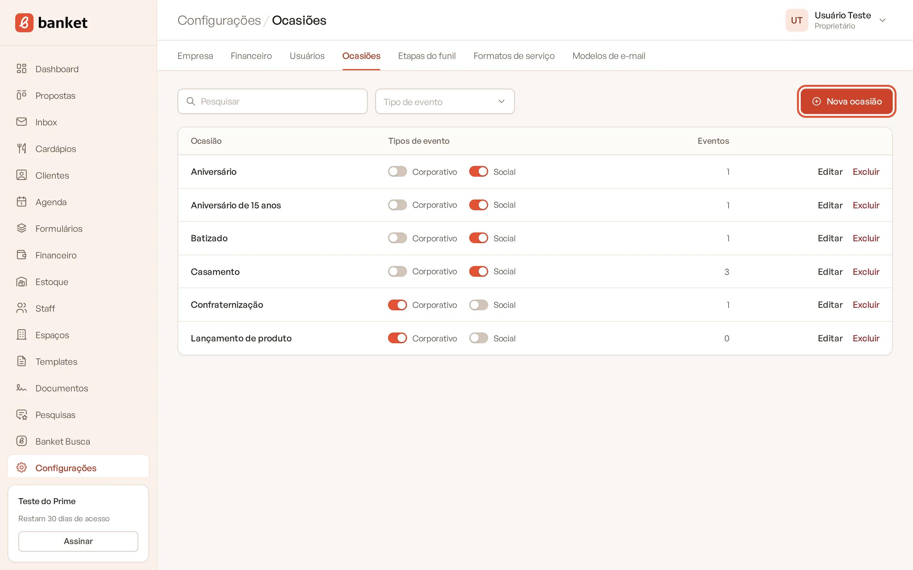
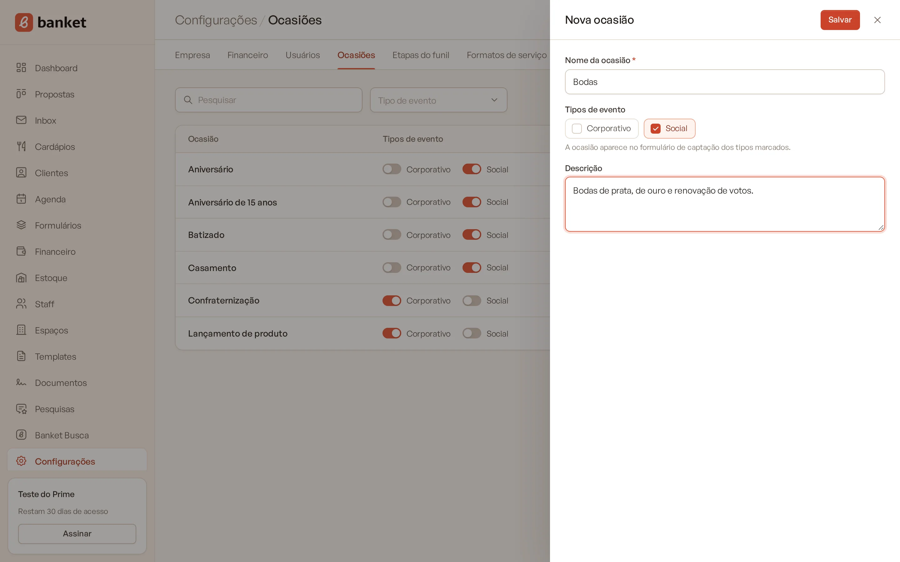
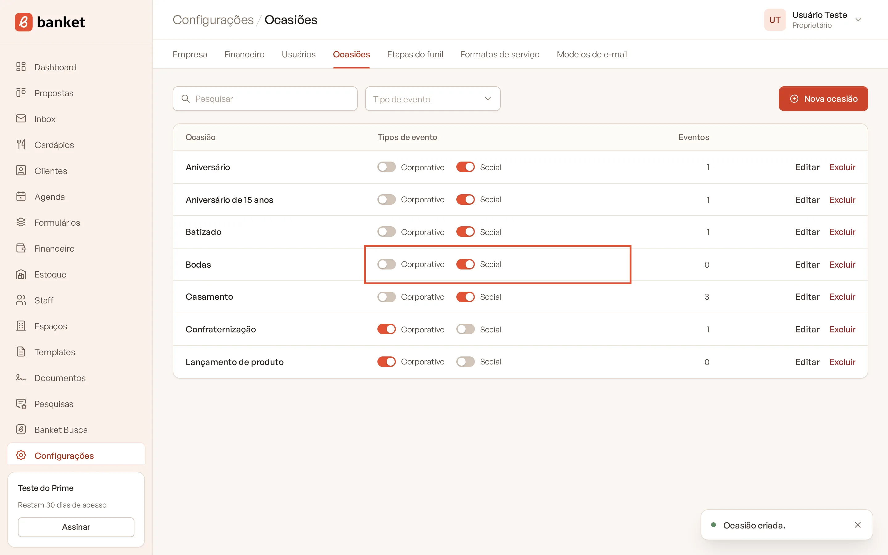

# Ocasiões

A **Ocasião** diz o motivo do evento: Casamento, Aniversário, Debutante, Confraternização, Lançamento de produto e assim
por diante. Cada ocasião é ligada a um ou aos dois **Tipos** de evento, **Corporativo** e **Social**. Essa ligação
define quais ocasiões aparecem no cadastro do evento e no formulário de captação.

> **Disponível em:** planos Essencial, Profissional, Prime e Master · **Quem pode usar:** Proprietário e Administrador

Os tipos **Corporativo** e **Social** são fixos e iguais para todas as empresas: não dá para criar, renomear ou apagar
tipos. Você personaliza só as ocasiões.

## Criar uma ocasião

1. No menu lateral, clique em **Configurações** e, no submenu, em **Ocasiões**.
2. Clique em **Nova ocasião**.

   

3. Preencha:
   - **Nome da ocasião** (obrigatório), por exemplo "Casamento" ou "Confraternização";
   - **Tipos de evento**: marque **Corporativo**, **Social** ou os dois;
   - **Descrição** (opcional).

   

4. Clique em **Salvar**.

## Ligar e desligar tipos direto na lista

Na coluna **Tipos de evento**, cada ocasião tem uma chave para **Corporativo** e outra para **Social**. Clique na chave
para ligar ou desligar: a mudança é salva na hora, sem precisar abrir a ocasião.

Para ver só as ocasiões de um tipo, use o filtro **Tipo de evento** no topo.

## Onde a ocasião é usada

- **Cadastro do evento**: o campo Ocasião mostra as ocasiões ligadas ao tipo escolhido.
- **Formulário de captação**: no fluxo corporativo aparecem as ocasiões ligadas a **Corporativo**; no fluxo social, as
  ligadas a **Social**. Se nenhuma ocasião estiver ligada a um tipo, a pergunta de ocasião não aparece nesse fluxo.
- **Título do evento**: quando o título fica em branco, o Banket monta "Ocasião – Cliente".

## Editar e excluir

- Clique no nome da ocasião ou em **Editar** para mudar nome, tipos e descrição.
- Clique em **Excluir** para apagar. A coluna **Eventos** mostra quantos eventos usam a ocasião: uma ocasião em uso não
  pode ser excluída. Nesse caso, desligue os dois tipos para ela deixar de aparecer nas opções.

## Perguntas frequentes

### Criei uma ocasião, mas ela não aparece no formulário.
Confira se ela está ligada ao tipo certo (Corporativo ou Social). Sem nenhum tipo ligado, a ocasião não aparece em
lugar nenhum.

### Posso criar um tipo novo, como "Religioso"?
Não. Os tipos são sempre Corporativo e Social. Crie "Religioso" como uma ocasião ligada ao tipo Social.

### Renomear uma ocasião muda os eventos antigos?
Sim. Os eventos guardam a ocasião, não o texto: todos passam a mostrar o nome novo.

## Artigos relacionados
- [Criar evento](../03-propostas-e-eventos/02-criar-evento.md)
- [Criar e editar formulário](../10-formularios/01-criar-e-editar-formulario.md)
- [Formatos de serviço](09-formatos-de-servico.md)
