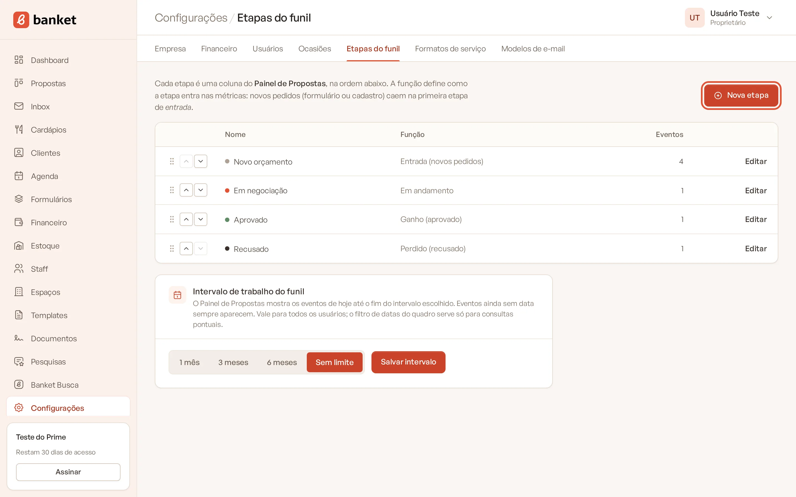
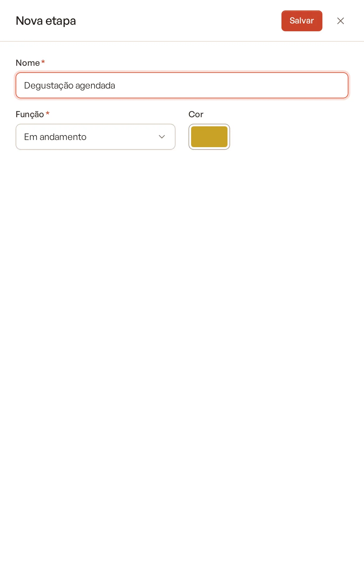
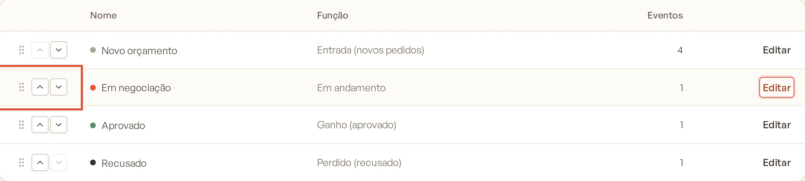
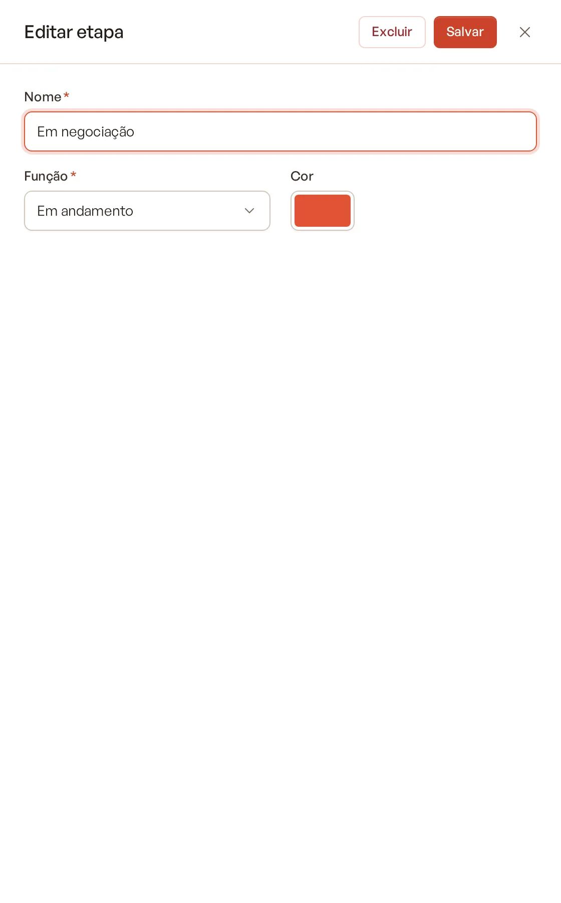
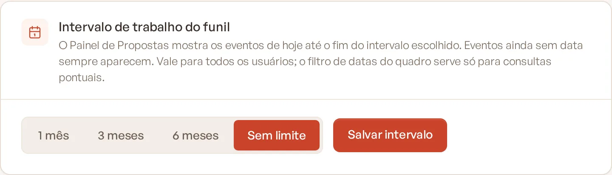

# Etapas do funil

Cada **Etapa** é uma coluna do **Painel de Propostas**, na ordem em que você as organiza. Você pode adaptar as etapas
ao processo de vendas do seu buffet, por exemplo: "Novo orçamento", "Degustação agendada", "Proposta enviada",
"Aprovado" e "Recusado".

> **Disponível em:** planos Essencial, Profissional, Prime e Master · **Quem pode usar:** Proprietário e Administrador

Toda empresa começa com quatro etapas: **Novo orçamento**, **Em negociação**, **Aprovado** e **Recusado**.

## Criar uma etapa

1. No menu lateral, clique em **Configurações** e, no submenu, em **Etapas do funil**.
2. Clique em **Nova etapa**.

   

3. Preencha:
   - **Nome** (obrigatório), por exemplo "Proposta enviada";
   - **Função**: como a etapa conta nas métricas (veja abaixo);
   - **Cor**: a cor da coluna e do ponto que identifica a etapa.

   

4. Clique em **Salvar**. A etapa nova entra no fim da lista.

## Funções das etapas

| Função | Para que serve |
|---|---|
| Entrada (novos pedidos) | Recebe os pedidos novos, do formulário ou do cadastro manual. Eles caem na **primeira** etapa de entrada. |
| Em andamento | Etapas de negociação. Ao criar o orçamento, o evento vai sozinho para a primeira etapa em andamento. |
| Ganho (aprovado) | Eventos fechados. Ao mover para cá, o sistema pede a data do fechamento. Contam como aprovados no Dashboard e liberam a pesquisa de satisfação depois do evento. |
| Perdido (recusado) | Eventos perdidos. Ao mover para cá, o sistema pede o motivo da perda. Contam como recusados no Dashboard. |

A taxa de conversão e os demais números do Dashboard usam a função da etapa, não o nome. Você pode ter várias etapas
com a mesma função.

## Mudar a ordem

Na lista, arraste a etapa pela alça à esquerda ou use os botões de mover para cima e para baixo. A ordem da lista é a
ordem das colunas no Painel de Propostas.

## Editar e excluir

1. Clique em **Editar** na linha da etapa.
2. Mude o nome, a função ou a cor e clique em **Salvar**, ou clique em **Excluir**.

   

Regras:
- A coluna **Eventos** mostra quantos eventos estão na etapa. Só é possível excluir etapas sem eventos: mova os eventos
  para outra coluna antes.
- A empresa precisa manter pelo menos uma etapa com a função **Entrada (novos pedidos)**.

## Intervalo de trabalho do funil

No card **Intervalo de trabalho do funil**, escolha até quando o Painel de Propostas mostra os eventos: **1 mês**,
**3 meses**, **6 meses** ou **Sem limite**, e clique em **Salvar intervalo**.

- O painel mostra os eventos de hoje até o fim do intervalo. Eventos ainda sem data sempre aparecem.
- A escolha vale para todos os usuários. O filtro de datas do painel serve para consultas pontuais e substitui o
  intervalo enquanto estiver preenchido.

## Perguntas frequentes

### Renomeei uma etapa. Os eventos mudam de lugar?
Não. Os eventos continuam na mesma etapa, que só ganha o nome novo.

### Por que um pedido novo não caiu na etapa que eu queria?
Os pedidos novos vão para a primeira etapa com a função **Entrada (novos pedidos)**, na ordem da lista. Coloque a etapa
desejada antes das outras de entrada.

### Posso usar a cor que quiser?
Sim. As etapas padrão usam os tons do Banket, mas você pode escolher qualquer cor.

## Artigos relacionados
- [Painel de Propostas](../03-propostas-e-eventos/01-painel-de-propostas.md)
- [Mover evento entre etapas](../03-propostas-e-eventos/04-mover-evento-entre-etapas.md)
- [Entender o Dashboard](../02-dashboard/01-entender-o-dashboard.md)
