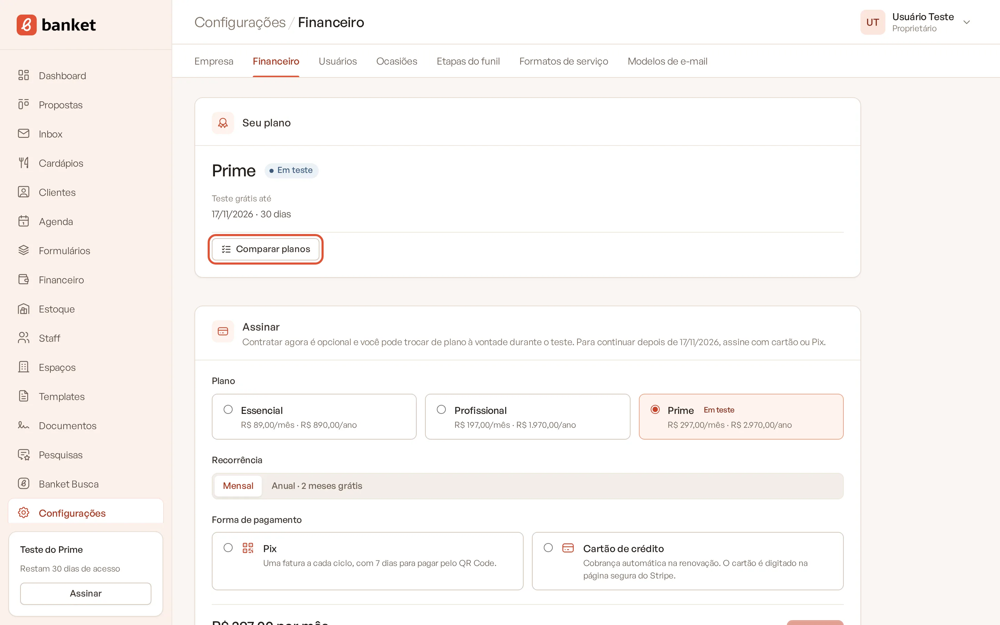
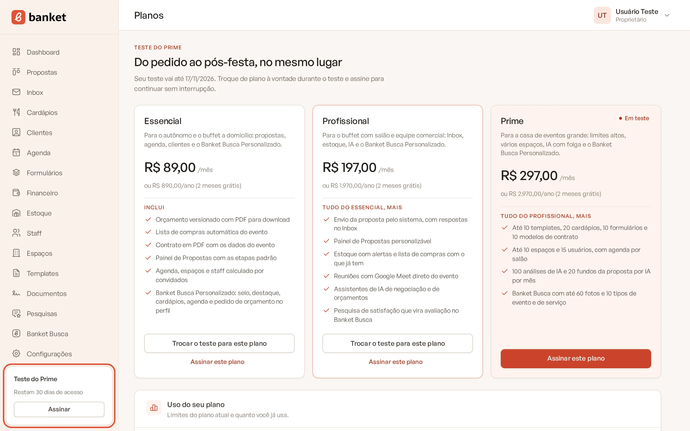
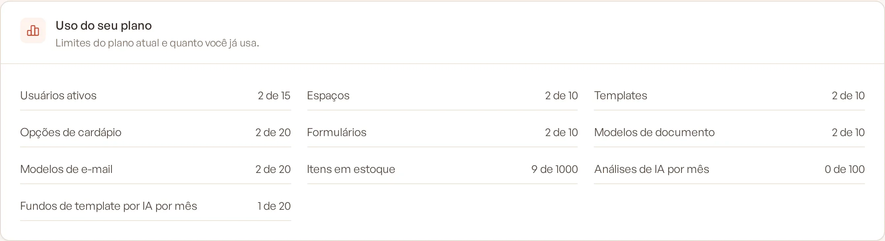
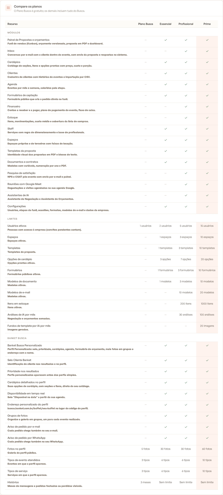
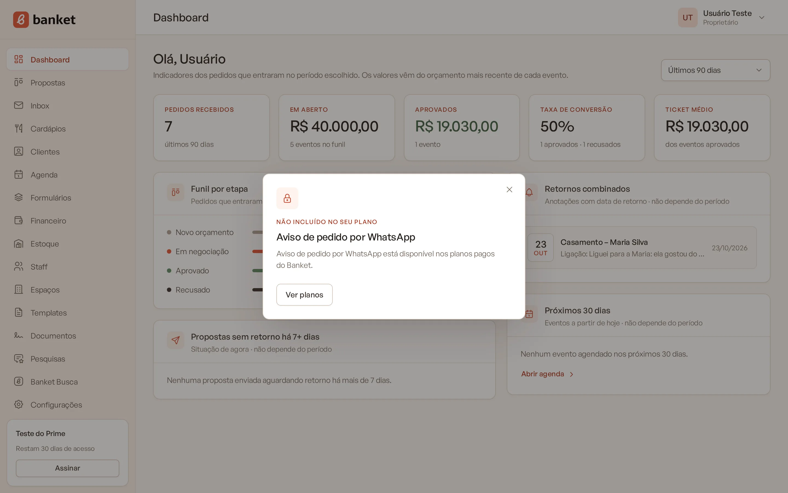

# Planos do Banket

O Banket tem um plano gratuito, o **Busca**, e quatro planos pagos: **Essencial**, **Profissional**, **Prime** e
**Master**. Cada plano libera um conjunto de módulos e define limites de uso (usuários, espaços, templates e outros).
Este artigo mostra o que cada plano inclui para você escolher o mais adequado ao seu buffet.

> **Disponível em:** todos os planos · **Quem pode usar:** todos veem os planos; só Proprietário e Administrador
> podem iniciar o teste, assinar ou trocar de plano

## Preços

| Plano | Mensal | Anual | Para quem |
|---|---|---|---|
| **Busca** | Gratuito para sempre | — | Ter um perfil no Banket Busca e receber pedidos de orçamento |
| **Essencial** | R$ 89,00/mês | R$ 890,00/ano | O autônomo e o buffet a domicílio: propostas, agenda, clientes e o Banket Busca Personalizado |
| **Profissional** | R$ 197,00/mês | R$ 1.970,00/ano | O buffet com salão e equipe comercial: Inbox, estoque, inteligência artificial e o Banket Busca Personalizado |
| **Prime** | R$ 297,00/mês | R$ 2.970,00/ano | A casa de eventos grande: limites altos, vários espaços e inteligência artificial com folga |
| **Master** | R$ 449,00/mês | R$ 4.490,00/ano | Grandes buffets e redes: tudo do Banket sem limites, com acompanhamento dedicado |

- No pagamento anual você paga 10 mensalidades e usa 12 meses (**2 meses grátis**).
- Todo plano pago pode ser testado por 30 dias, sem cartão. Veja [Teste grátis de 30 dias](02-teste-gratis-de-30-dias.md).
- O **Master** não é contratado pelo app: ele é contratado falando com a equipe do Banket (veja abaixo).

## O que cada plano inclui

### Módulos

| Módulo | Busca | Essencial | Profissional | Prime | Master |
|---|---|---|---|---|---|
| Banket Busca (perfil público e pedidos de orçamento) | Perfil Simples | Perfil Personalizado | Perfil Personalizado | Perfil Personalizado | Perfil Personalizado |
| Painel de Propostas, orçamentos, proposta em PDF e Dashboard | — | Sim | Sim | Sim | Sim |
| Cardápios | — | Sim | Sim | Sim | Sim |
| Clientes | — | Sim | Sim | Sim | Sim |
| Agenda | — | Sim | Sim | Sim | Sim |
| Formulários de captação | — | Sim | Sim | Sim | Sim |
| Staff | — | Sim | Sim | Sim | Sim |
| Espaços | — | Sim | Sim | Sim | Sim |
| Templates da proposta | — | Sim | Sim | Sim | Sim |
| Documentos e contratos | — | Sim | Sim | Sim | Sim |
| Configurações completas (usuários, etapas, ocasiões, formatos) | Só Empresa e Financeiro | Sim | Sim | Sim | Sim |
| Inbox (envio da proposta e respostas por e-mail) | — | — | Sim | Sim | Sim |
| Financeiro (contas a receber e a pagar, plano de pagamento) | — | — | Sim | Sim | Sim |
| Estoque | — | — | Sim | Sim | Sim |
| Reuniões com Google Meet | — | — | Sim | Sim | Sim |
| Assistentes de IA (negociação e orçamentos) | — | — | Sim | Sim | Sim |
| Pesquisa de satisfação | — | — | Sim | Sim | Sim |

### Limites

| Limite | Busca | Essencial | Profissional | Prime | Master |
|---|---|---|---|---|---|
| Usuários | 1 | 2 | 5 | 15 | Sem limite |
| Espaços | — | 1 | 3 | 10 | Sem limite |
| Templates da proposta | — | 1 | 3 | 10 | Sem limite |
| Opções de cardápio (ativas) | — | 3 | 7 | 20 | Sem limite |
| Formulários (ativos) | — | 1 | 3 | 10 | Sem limite |
| Modelos de documento (ativos) | — | 1 | 3 | 10 | Sem limite |
| Modelos de e-mail (ativos) | — | — | 10 | 20 | Sem limite |
| Itens de estoque (ativos) | — | — | 200 | 1.000 | Sem limite |
| Análises de IA por mês | — | — | 30 | 100 | Sem limite |
| Imagens de fundo da proposta por IA por mês | — | — | — | 20 | Sem limite |

### Banket Busca

| Recurso do perfil | Busca | Essencial | Profissional | Prime | Master |
|---|---|---|---|---|---|
| Tipo de perfil | Simples | Personalizado | Personalizado | Personalizado | Personalizado |
| Fotos no perfil | 5, sem grupos | 30, em grupos | 30, em grupos | 60, em grupos | Sem limite, em grupos |
| Tipos de evento atendidos | 3 | 6 | 6 | 10 | Sem limite |
| Tipos de serviço | 3 | 6 | 6 | 10 | Sem limite |
| Selo Cliente Banket e prioridade nos resultados | — | Sim | Sim | Sim | Sim |
| Cardápios detalhados no perfil | — | Sim | Sim | Sim | Sim |
| Disponibilidade na data a partir da sua agenda | — | Sim | Sim | Sim | Sim |
| Endereço do perfil com o nome do buffet | — | Sim | Sim | Sim | Sim |
| Aviso de pedido por e-mail e por WhatsApp | — | Sim | Sim | Sim | Sim |
| Histórico de mensagens e pedidos encerrados | 3 meses | Completo | Completo | Completo | Completo |

Para entender a diferença entre os dois tipos de perfil, veja
[Perfil Simples e Personalizado](../18-banket-busca/02-perfil-simples-e-personalizado.md).

## Ver os planos no sistema

1. No menu lateral, clique no card do plano no rodapé do menu (**Ver planos** ou **Iniciar teste grátis**), ou vá em
   **Configurações › Financeiro** e clique em **Comparar planos**.

   

2. Na página **Planos** você vê:
   - os cards do Essencial, do Profissional e do Prime, com preço, destaques e o botão de ação;
   - o card **Uso do seu plano**, com quanto você já usa de cada limite;
   - a tabela **Compare os planos**, com todos os módulos, limites e recursos do Banket Busca.

   

   

   

3. O plano atual aparece marcado com **Seu plano** (ou **Em teste**, durante o teste).

## Plano Master

O Master libera todos os recursos sem nenhum limite e inclui acompanhamento dedicado. Ele não aparece nos cards da
página **Planos** e não é contratado pelo app: para contratá-lo, fale com a equipe do Banket pelo site
(banket.com.br, seção de contato) ou abra um chamado em **Suporte**.

## O que acontece quando um recurso não está no seu plano

- O item do menu continua visível, com um **cadeado**.
- Ao clicar, abre um painel explicando o recurso, com os botões **Ver planos** e, se a sua empresa ainda não usou o
  teste, **Iniciar teste grátis de 30 dias**.
- Quando um limite é atingido, o painel mostra **Limite do plano** e quanto você já usa. Veja
  [Limites do plano](09-limites-do-plano.md).

## Perguntas frequentes

### O plano Busca é gratuito para sempre?
Sim. Ele não tem teste, cobrança nem prazo. Você mantém o perfil no Banket Busca e recebe pedidos de orçamento sem pagar.

### Posso mudar de plano depois?
Sim. Durante o teste a troca é livre e não muda o prazo. Com assinatura, a troca é feita em **Configurações ›
Financeiro**. Veja [Trocar de plano](05-trocar-de-plano.md).

### O anual tem desconto?
Sim. O anual custa o equivalente a 10 mensalidades, ou seja, 2 meses grátis em relação ao mensal.

### Usuários comuns podem assinar?
Não. A página **Planos** mostra a mensagem "Só proprietários e administradores podem escolher ou assinar um plano."
Peça ao responsável pela conta.

## Artigos relacionados
- [Teste grátis de 30 dias](02-teste-gratis-de-30-dias.md)
- [Contratar a assinatura](03-contratar-assinatura.md)
- [Limites do plano](09-limites-do-plano.md)
- [Perfil Simples e Personalizado](../18-banket-busca/02-perfil-simples-e-personalizado.md)
- [Conhecer o menu e a navegação](../01-primeiros-passos/07-conhecer-o-menu-e-a-navegacao.md)
