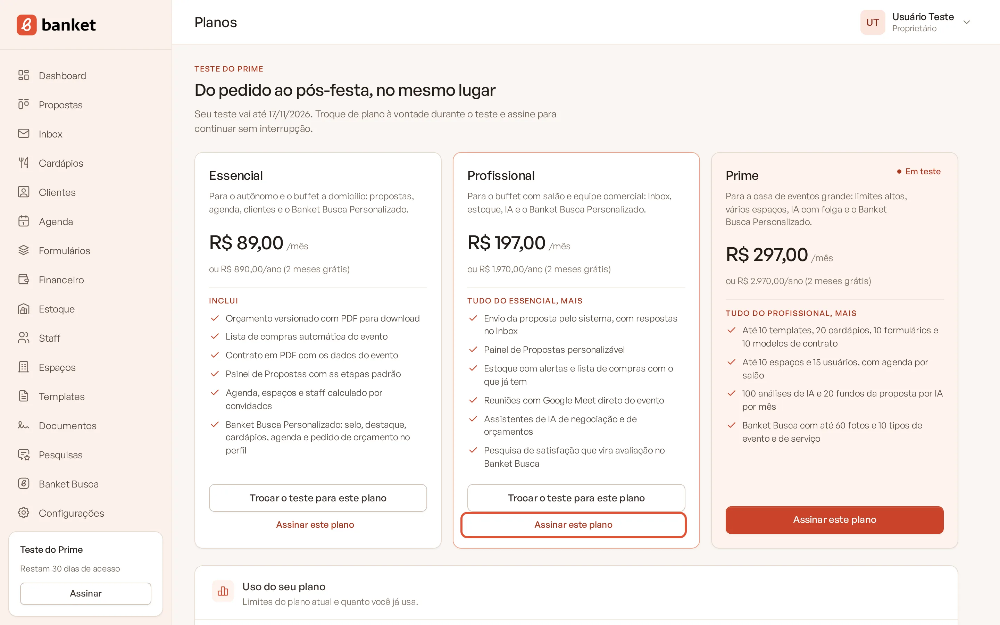
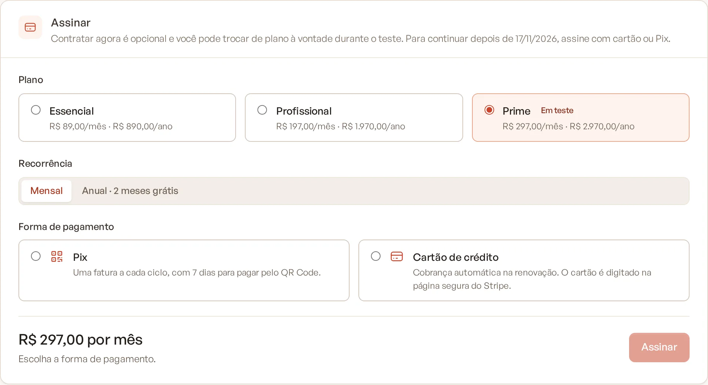
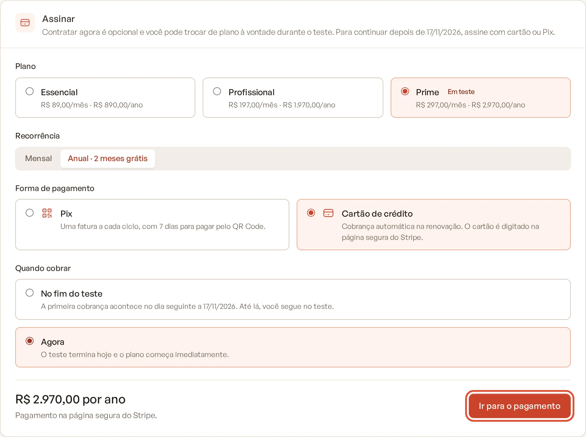
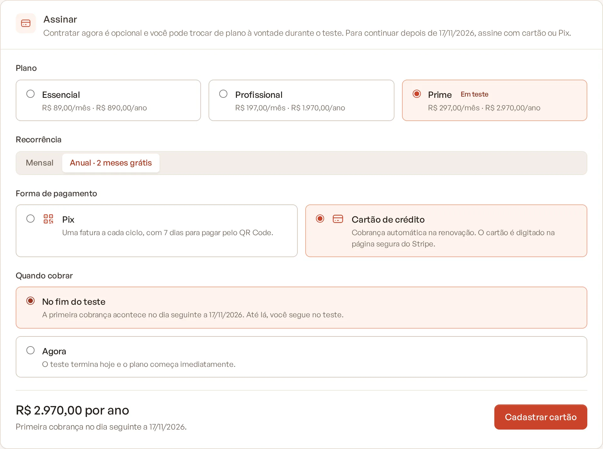
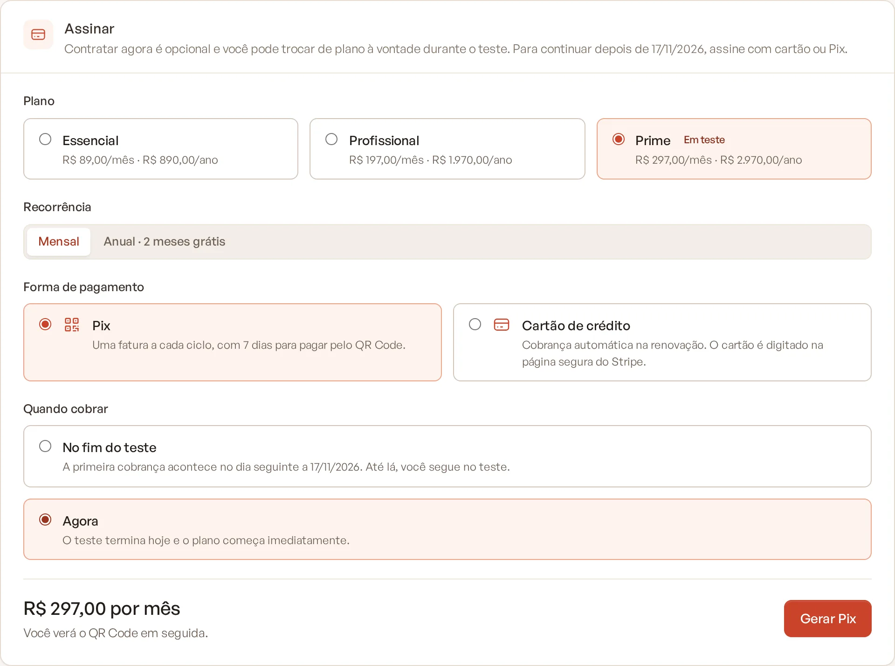
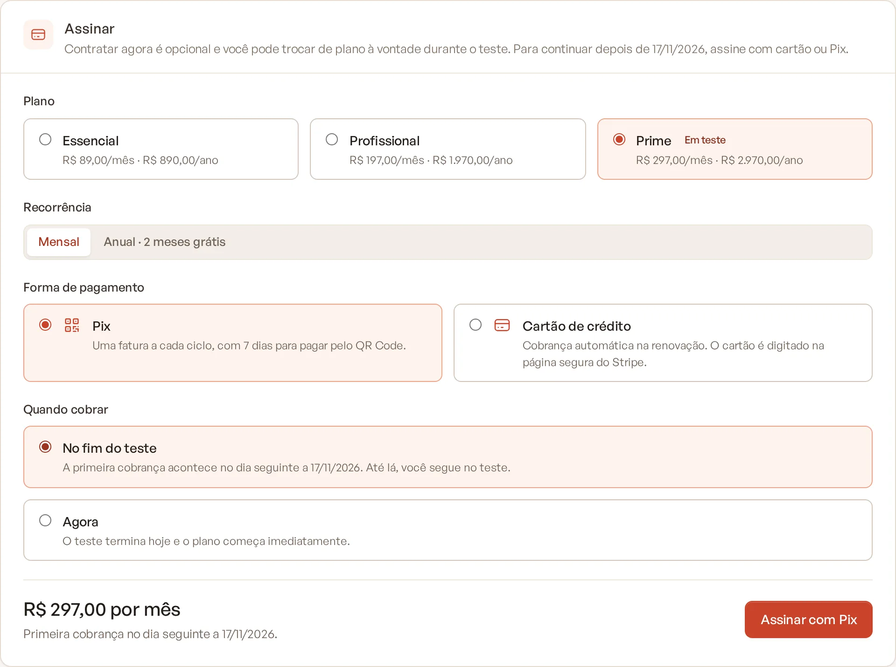

# Contratar a assinatura

A assinatura mantém sua empresa num plano pago depois do teste grátis (ou a qualquer momento, se o teste já foi usado).
Você escolhe o plano, a recorrência (mensal ou anual) e a forma de pagamento: cartão de crédito ou Pix.

> **Disponível em:** planos Essencial, Profissional e Prime (o Master é contratado com a equipe) · **Quem pode usar:**
> Proprietário e Administrador

## Antes de começar

- Em **Configurações › Empresa**, informe um **CPF ou CNPJ válido** e, se a empresa for pessoa jurídica, a **razão
  social**. Esses dados vão na cobrança e na nota fiscal. Sem eles, a tela mostra um aviso e o botão de assinar fica
  desativado. Veja [Dados da empresa](../19-configuracoes/01-dados-da-empresa.md).
- Se a empresa nunca usou o teste grátis, a tela de assinatura oferece primeiro o teste: **Escolher plano e começar o
  teste**. Você pode assinar durante o teste.

## Passo a passo

1. No menu lateral, clique em **Configurações** e depois em **Financeiro**. (Na página **Planos**, o botão **Assinar
   este plano** leva para o mesmo lugar, com o plano já selecionado.)

   

2. No card **Assinar**, escolha:
   - **Plano**: Essencial, Profissional ou Prime, com o preço mensal e anual;
   - **Recorrência**: **Mensal** ou **Anual · 2 meses grátis**;
   - **Forma de pagamento**: **Pix** ou **Cartão de crédito**;
   - **Quando cobrar** (só aparece durante o teste): **No fim do teste** ou **Agora**.

   

3. Confira o valor no rodapé do card (por exemplo, "R$ 197,00 por mês").
4. Clique no botão de confirmação. O nome dele muda conforme a escolha:

   

   

   

   

| Forma | Quando cobrar | Botão | O que acontece |
|---|---|---|---|
| Cartão | Agora | **Ir para o pagamento** | Abre a página segura de pagamento para você digitar o cartão. A cobrança é feita na hora. |
| Cartão | No fim do teste | **Cadastrar cartão** | Você cadastra o cartão na página segura. A primeira cobrança acontece no dia seguinte ao último dia do teste. |
| Pix | Agora | **Gerar Pix** | Abre a tela **Pagar com Pix** com o QR Code da primeira fatura. |
| Pix | No fim do teste | **Assinar com Pix** | O plano fica contratado. A primeira fatura Pix é gerada no fim do teste. |

5. No cartão, depois do pagamento você volta ao Banket e vê "Confirmando sua assinatura com o meio de pagamento…".
   A página se atualiza sozinha quando a confirmação chega. Se você desistir na página de pagamento, aparece
   "Pagamento não concluído. Nada foi cobrado."

## O que acontece depois

- **O plano pago só entra depois que o pagamento é confirmado.** Enquanto isso, o card **Seu plano** mostra
  "Aguardando a confirmação do pagamento do plano ...".
- Assinar com cobrança **Agora** durante o teste encerra o teste: o plano começa imediatamente.
- Assinar para cobrar **No fim do teste** mantém o teste até a data final. O card **Seu plano** mostra
  **Contratado · em teste** e a data da **Primeira cobrança**.
- Com a assinatura ativa, o card **Seu plano** mostra o **Valor**, a **Próxima cobrança** e a **Forma de pagamento**.
- Proprietários e administradores recebem o e-mail "Assinatura do plano ... confirmada".

## Cartão ou Pix?

- **Cartão de crédito**: a renovação é cobrada automaticamente a cada mês ou ano. O cartão é digitado numa página segura
  de pagamento, nunca dentro do Banket.
- **Pix**: a cada ciclo é gerada uma fatura com **7 dias para pagar** pelo QR Code. Você recebe o aviso por e-mail.
  Veja [Pagar com Pix](04-pagar-com-pix.md).

## Perguntas frequentes

### No cartão, por que não consigo escolher cobrar no fim do teste?
Quando faltam menos de 2 dias para o fim do teste, o cartão só aceita cobrança imediata. A mensagem é "Faltam menos de 2
dias para o fim do teste: no cartão, escolha cobrar agora."

### Assinei com Pix para o fim do teste. Preciso fazer algo?
Sim: pague a primeira fatura assim que ela for gerada no fim do teste. Enquanto nenhuma fatura da assinatura foi paga,
vale a regra do teste: se o pagamento não for confirmado até o meio-dia do dia seguinte ao último dia do teste, a empresa
volta ao plano Busca. Para evitar esse risco, escolha **Agora** e pague antes do fim do teste.

### Gerei um Pix e não paguei. A contratação fica valendo?
Não. Se a primeira fatura Pix não for paga até o meio-dia do dia seguinte ao vencimento, a contratação é desfeita. Se o
seu teste ainda estiver valendo, ele continua até a data final. Você pode contratar de novo quando quiser.

### Já tenho assinatura e quero outro plano. Assino de novo?
Não. Use **Trocar plano** no mesmo lugar. Veja [Trocar de plano](05-trocar-de-plano.md).

### Como contrato o Master?
O Master não aparece na lista de planos do app. Fale com a equipe do Banket pelo site ou abra um chamado em
[Suporte](../21-suporte/01-abrir-chamado.md).

## Artigos relacionados
- [Pagar com Pix](04-pagar-com-pix.md)
- [Faturas e cartão](07-faturas-e-cartao.md)
- [Trocar de plano](05-trocar-de-plano.md)
- [Teste grátis de 30 dias](02-teste-gratis-de-30-dias.md)
- [Dados da empresa](../19-configuracoes/01-dados-da-empresa.md)
