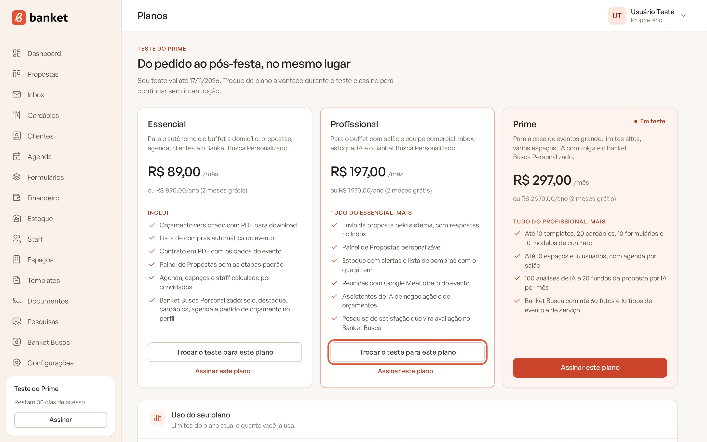
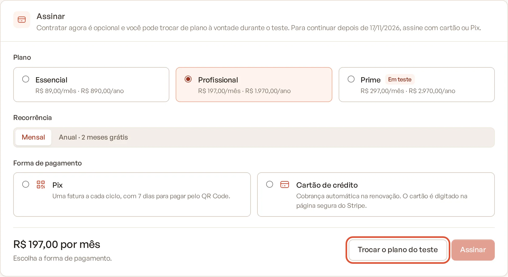

# Trocar de plano

Você pode mudar de plano quando quiser. A forma de fazer e a cobrança dependem do momento: durante o teste grátis a
troca é livre; com a assinatura ativa, a mudança para um plano maior cobra a diferença na hora e a mudança para um plano
menor ajusta a próxima fatura.

> **Disponível em:** planos Essencial, Profissional e Prime · **Quem pode usar:** Proprietário e Administrador

## Durante o teste grátis (sem assinatura)

A troca é imediata, sem pagamento, e **não muda a data final do teste**.

1. No menu lateral, abra a página **Planos** (pelo card do plano no rodapé do menu ou por **Configurações › Financeiro
   › Comparar planos**).
2. No card do plano desejado, clique em **Trocar o teste para este plano**.

   

3. Aparece a mensagem "Seu teste agora é do plano ... O prazo do teste continua o mesmo."

Outra forma: em **Configurações › Financeiro**, no card **Assinar**, selecione o plano e clique em **Trocar o plano do
teste**.

## Com a assinatura ativa

1. No menu lateral, clique em **Configurações** e depois em **Financeiro**.
2. No card **Trocar de plano**, selecione o novo plano e a **Recorrência** (**Mensal** ou **Anual · 2 meses grátis**).
   O plano atual aparece com a marca **Atual**.
3. Clique em **Trocar plano** e confirme em **Trocar plano** na janela que abrir.

Na página **Planos**, o botão **Mudar para este plano** leva ao mesmo card, com o plano já selecionado.

### Como a diferença é cobrada

A comparação é feita pelo valor por mês de cada opção (no anual, o valor do ano dividido por 12).

| Mudança | Cartão de crédito | Pix |
|---|---|---|
| **Para um plano mais caro** | A diferença proporcional ao tempo que falta no período é cobrada **na hora**. O plano novo só entra se o pagamento for aprovado. Se for recusado, nada muda e aparece "O pagamento da diferença não foi aprovado. Confira o cartão em "Cartão e recibos" e tente de novo." | É gerada uma **fatura da diferença**. O plano novo entra **quando essa fatura for paga**; até lá você continua no plano atual e o card **Seu plano** mostra "Aguardando a confirmação do pagamento do plano ...". Pague pelo botão **Pagar com Pix**. |
| **Para um plano mais barato** | A troca vale **na hora** e o crédito proporcional entra na **próxima fatura**. | A troca vale **na hora** e o crédito proporcional entra na **próxima fatura**. |

Se você assinou para cobrar **No fim do teste** e o teste ainda não acabou, qualquer troca vale na hora e o ajuste entra
na primeira fatura.

## O que acontece com os seus dados ao trocar

- **Para um plano maior**: os novos módulos e limites são liberados assim que o plano entra.
- **Para um plano menor**: nada é apagado. Módulos que o plano novo não tem passam a aparecer com cadeado, e você não
  consegue criar itens acima dos novos limites (o que já existe continua). No Banket Busca, fotos e tipos de evento ou
  de serviço acima do limite do novo plano saem do perfil público e voltam se você subir de plano de novo.
  Veja [Limites do plano](09-limites-do-plano.md).

## Perguntas frequentes

### Posso trocar só a recorrência, de mensal para anual?
Sim. Selecione o mesmo plano com outra **Recorrência** e clique em **Trocar plano**. A cobrança segue a tabela acima,
comparando o valor por mês de cada opção.

### Quero o plano Master. Como faço?
O Master não está disponível para troca pelo app. Fale com a equipe do Banket pelo site ou abra um chamado em
[Suporte](../21-suporte/01-abrir-chamado.md).

### Troquei para um plano maior no Pix e não paguei a diferença. O que acontece?
Você continua no plano atual. A fatura da diferença fica em aberto no card **Faturas**. Como qualquer fatura, se não for
paga até o meio-dia do dia seguinte ao vencimento, a empresa volta ao plano Busca. Pague a fatura ou fale com a equipe
se mudou de ideia.

### Posso voltar para o plano Busca (gratuito)?
Sim, cancelando a assinatura. O acesso continua até o fim do período pago. Veja
[Cancelar a assinatura](06-cancelar-assinatura.md).

## Artigos relacionados
- [Planos do Banket](01-planos-do-banket.md)
- [Limites do plano](09-limites-do-plano.md)
- [Pagar com Pix](04-pagar-com-pix.md)
- [Faturas e cartão](07-faturas-e-cartao.md)
- [Cancelar a assinatura](06-cancelar-assinatura.md)
