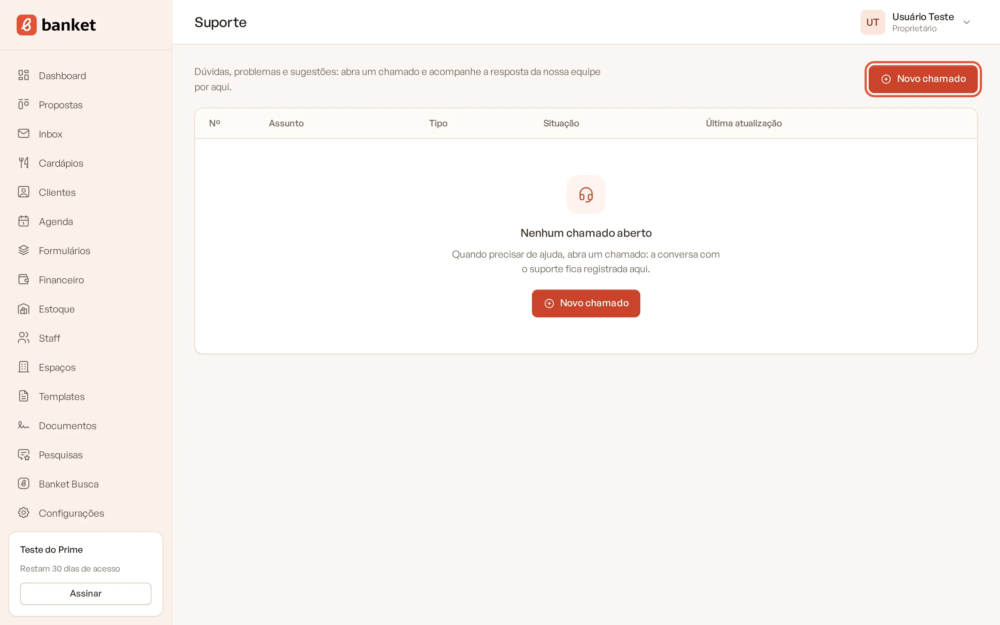
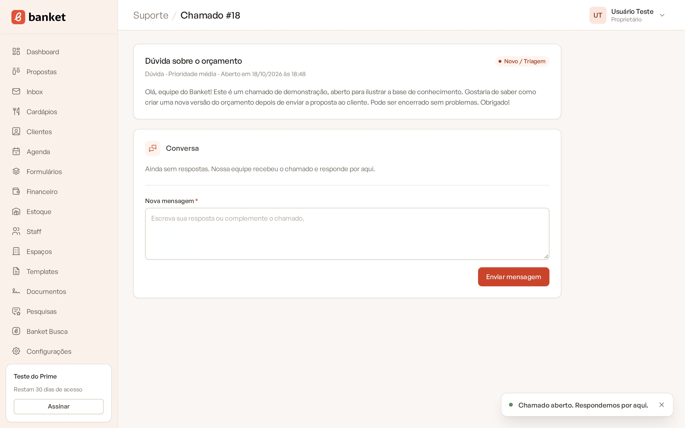
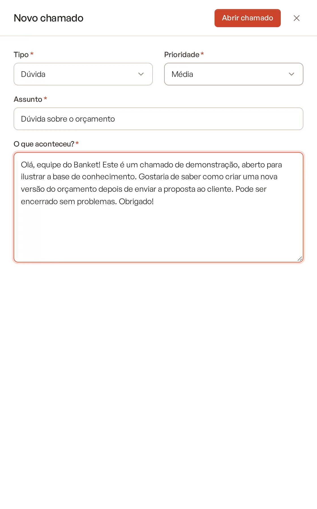
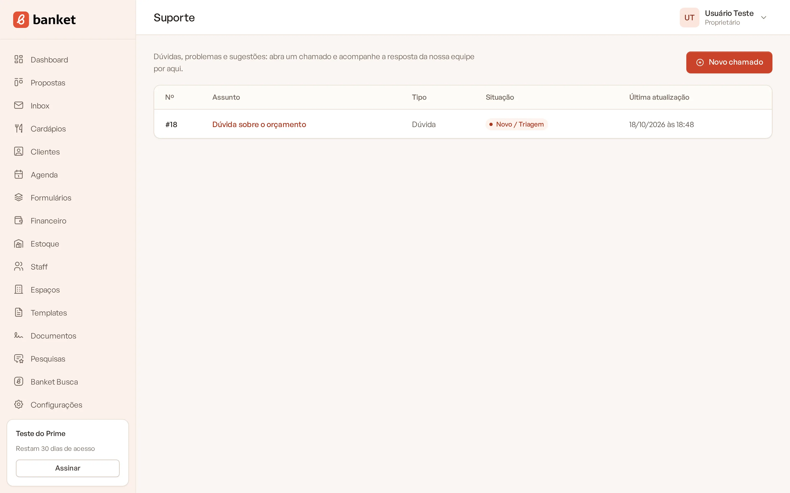

# Abrir chamado

Quando tiver uma dúvida, encontrar um problema ou quiser dar uma sugestão, abra um chamado no menu **Suporte**. A equipe
do Banket responde dentro do próprio chamado, e toda a conversa fica registrada.

> **Disponível em:** todos os planos · **Quem pode usar:** todos os usuários

## Passo a passo

1. No menu lateral, clique em **Suporte**.
2. Clique em **Novo chamado**.

   

3. Preencha os campos (veja a tabela abaixo).
4. Clique em **Abrir chamado**.

   

O Banket confirma com "Chamado aberto. Respondemos por aqui." e abre a página do chamado.

## Entenda os campos

| Campo | O que preencher |
|---|---|
| **Tipo** | **Dúvida**, **Problema ou erro**, **Financeiro**, **Sugestão** ou **Outro assunto**. |
| **Prioridade** | **Baixa**, **Média** (padrão), **Alta** ou **Crítica**. |
| **Assunto** | Um resumo curto. Exemplo: "Não consigo gerar o PDF da proposta". |
| **O que aconteceu?** | Conte o que você estava fazendo, o que esperava e o que apareceu na tela. Até 5.000 caracteres. |

### Dicas para uma resposta mais rápida

- Abra o chamado a partir da página onde o problema aconteceu: o Banket envia junto, automaticamente, o endereço da
  página de onde você veio, o que ajuda a equipe a reproduzir o problema.
- Copie no texto a mensagem de erro exatamente como ela apareceu.
- Diga o nome do evento, do cliente ou do registro envolvido.
- Use **Crítica** só quando algo impede o trabalho do buffet, como não conseguir enviar propostas.

## A lista de chamados

A página **Suporte** mostra os seus chamados com:

- **Nº**: o número do chamado;
- **Assunto**: clique para abrir;
- **Tipo**;
- **Situação**: em destaque enquanto o chamado está em andamento;
- **Última atualização**.

Cada pessoa vê apenas os chamados que ela mesma abriu, na empresa em que está no momento.

## Perguntas frequentes

### Apareceu "Suporte indisponível no momento".

O serviço de chamados não respondeu. Aguarde alguns instantes e recarregue a página.

### Um colega abriu um chamado. Consigo ver?

Não. Os chamados são individuais. Peça ao colega para acompanhar e repassar a resposta, ou abra um chamado seu.

### Trabalho em duas empresas. Os chamados se misturam?

Não. A lista mostra só os chamados abertos na empresa atual. Para ver os da outra empresa, troque de empresa pelo menu do
seu nome.

## Artigos relacionados

- [Acompanhar e responder chamado](02-acompanhar-e-responder-chamado.md)
- [Trocar de empresa](../01-primeiros-passos/08-trocar-de-empresa.md)
